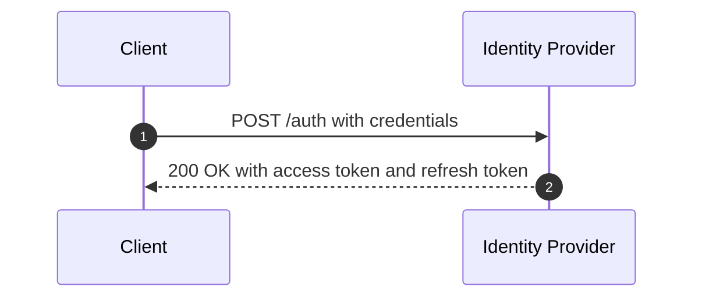
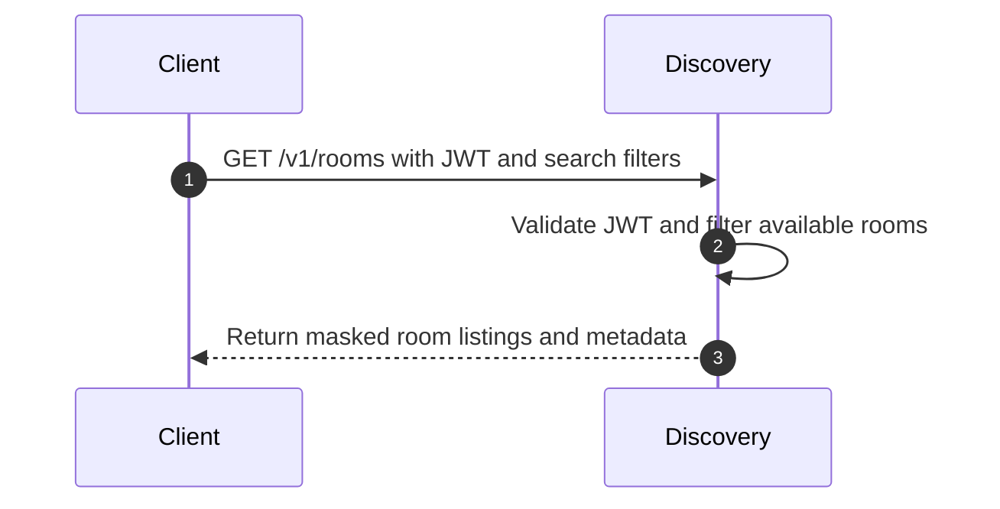
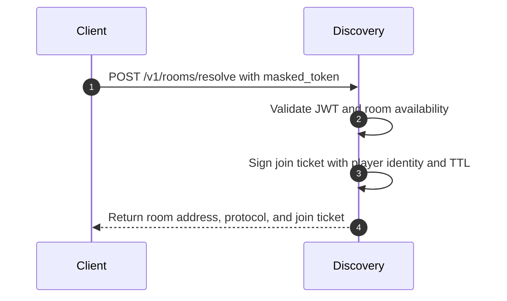
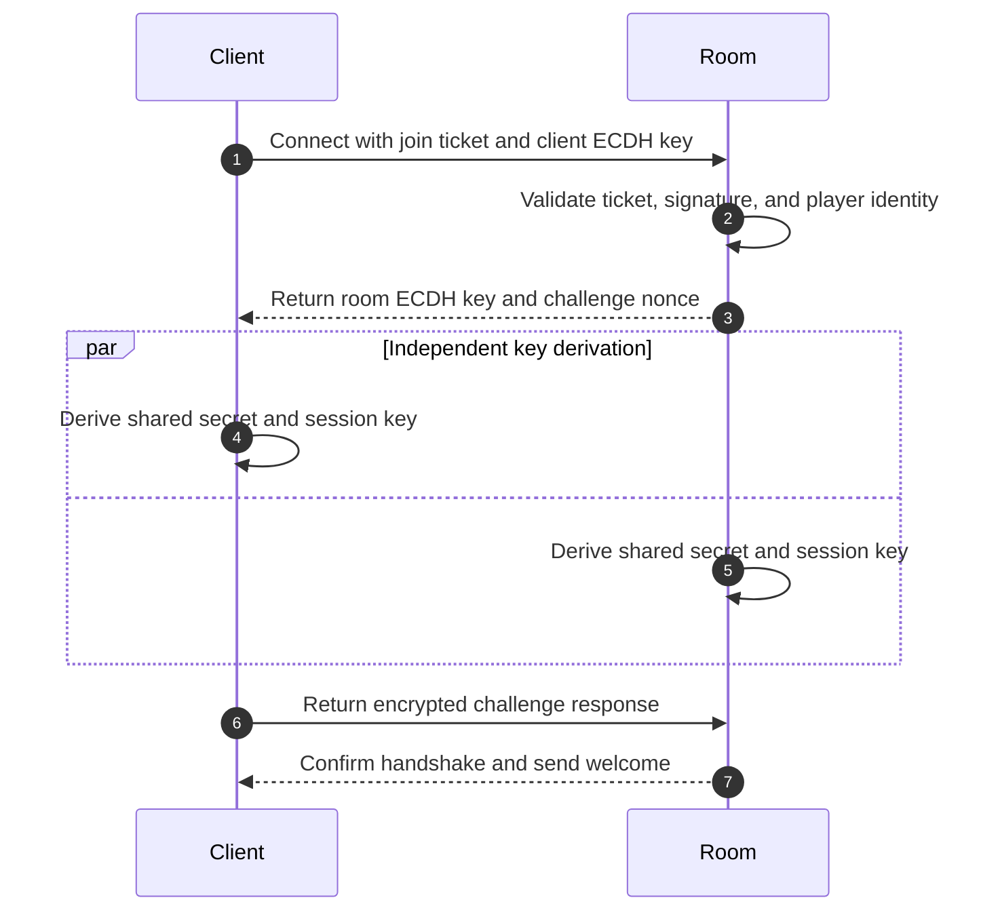
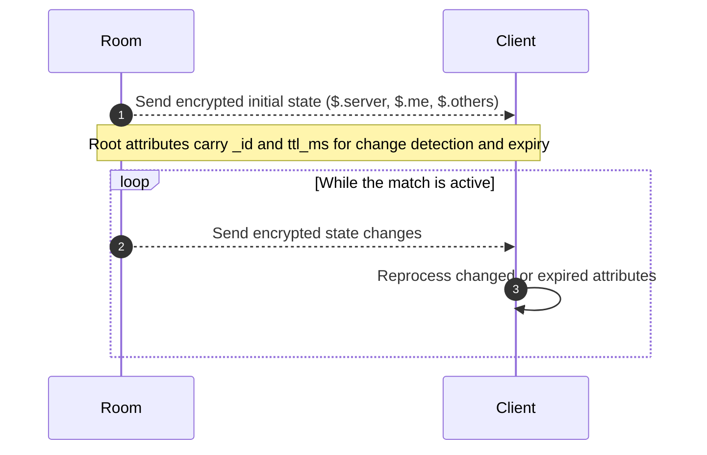
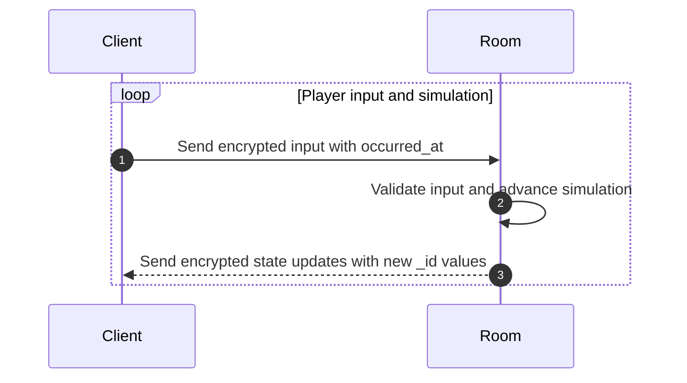
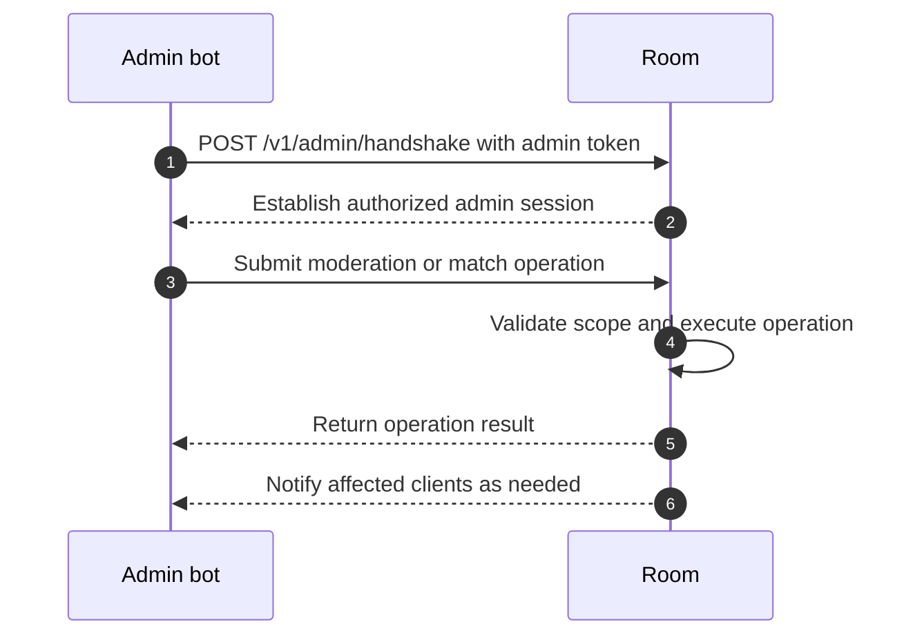

# End-to-End Flow

This is the complete flow for a player, from authentication to state synchronization inside a room.

## 1. Authentication

**What happens:**
- The client presents credentials (username/password, social login, and so on)
- The IdP validates them and issues a JWT with the player's claims (id, username, email, and so on)
- The client stores the JWT in memory or in secure storage

---

## 2. Room Discovery

**What happens:**
1. The client sends a GET request with a Bearer JWT.
2. Discovery validates the JWT against the IdP's JWKS.
3. Discovery filters rooms by query parameters (game_mode, language, and so on).
4. Discovery returns **masked rooms** (real addresses hidden, only IDs exposed).

---

## 3. Resolution and Join Ticket

**What happens:**
1. The client chooses a room and sends a POST request.
2. Discovery validates the JWT again and checks that the room exists.
3. Discovery issues a **signed join ticket** with:
   - Room ID
   - Player ID (taken from the JWT)
   - TTL (300 seconds)
   - HMAC signature
4. Discovery returns the room's real address and the ticket.

---

## 4. ECDH Handshake

**What happens:**
1. The client connects over WebSocket and sends the join ticket and JWT.
2. The room validates:
   - The ticket's TTL
   - The ticket's signature
   - The player's JWT
3. The room and the client exchange ECDH public keys.
4. Both sides derive the **shared secret** independently and identically.
5. A KDF (Key Derivation Function) produces the **session key** from the shared secret.
6. The handshake is verified with a cryptographic challenge.
7. Handshake complete: the session is established.

---

## 5. Reactive State Sync

**What happens:**
1. The client receives state in three dictionaries:
   - `$.server`: global state
   - `$.me`: player data
   - `$.others`: opponent data
2. Every root-level attribute has `_id` and `ttl_ms`.
3. The client processes only changes (differences in `_id`).
4. The client reprocesses an attribute when its `ttl_ms` expires.

---

## 6. Input Loop

**What happens:**
1. The client sends inputs (movement, actions), encrypted.
2. The room validates and applies the inputs.
3. The room simulates the state and produces updates.
4. The room sends updates with updated `_id` and `ttl_ms`.
5. The client receives them, checks `_id`, and reprocesses only what changed.
6. The loop continues until the match ends.

---

## 7. Admin Intervention (Optional)

**What happens:**
- The admin sends operations (kick, pause, inject events).
- The room validates the admin token (a JWT with `admin_scope`).
- The room executes the operation and notifies all affected clients.

---

## Security Summary at Each Step

| Step | Protection |
|------|------------|
| **Authentication** | JWT signed by the IdP |
| **Discovery** | JWT validated against JWKS |
| **Resolution** | Signed join ticket + TTL |
| **Handshake** | ECDH + challenge-response |
| **State sync** | AES-256-GCM / ChaCha20 |
| **Admin** | Admin token (JWT with scope) |

Each step ensures that only authorized players and administrators can join or control the room.

Continue to the detailed specifications:
- [Discovery Server](../discovery/overview)
- [Room Protocol](../room-protocol/overview)
- [Admin API](../admin/overview)
