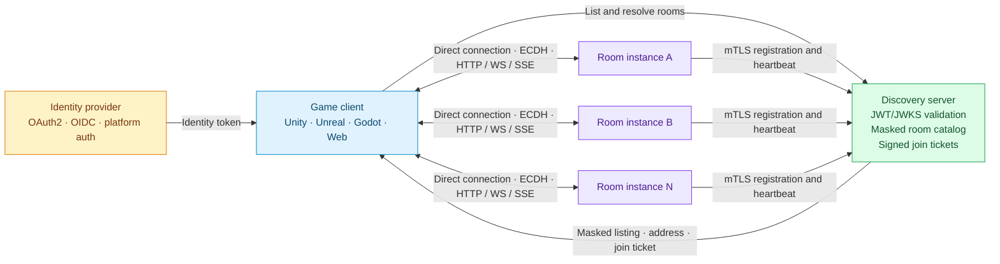

# Architecture Overview

The **Open Game Server Ecosystem** is a decentralized, high-performance architecture for managing multiplayer game rooms and discovering matches.

## Ecosystem Layers

## Connection Flow

1. **Authentication**: the client obtains a JWT/ticket from the IdP.
2. **Discovery**: the client queries Discovery with a Bearer JWT.
3. **Listing**: Discovery returns masked rooms and filters.
4. **Resolution**: the client chooses a room and gets its address and a join ticket.
5. **Handshake**: the client establishes ECDH with the room.
6. **Synchronization**: client and room exchange reactive state with `_id`/`ttl_ms`.

## Responsibilities by Layer

| Layer | What it does | Security |
|-------|--------------|----------|
| **IdP** | Issues player credentials | OAuth2 / OIDC / public key |
| **Discovery** | Aggregates rooms, masks addresses, issues tickets | mTLS (rooms) + JWT/JWKS (clients) |
| **Room** | Runs the match simulation | ECDH + AES-256-GCM / ChaCha20 |
| **Client** | Renders the game, syncs inputs | Shared secret derived by ECDH |

## Advantages of This Architecture

✅ **Horizontal scalability**: add rooms without redesigning the architecture
✅ **Resilience**: a failing room does not affect other rooms
✅ **Multi-tenancy**: multiple games and providers can use the same Discovery
✅ **Engine-agnostic**: any client (Unity, Godot, Web) works
✅ **Layered security**: there is no single cryptographic point of failure

Continue with the individual [Components](components).
