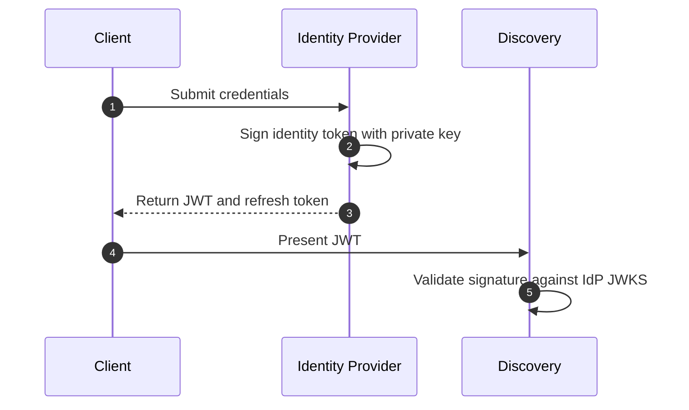
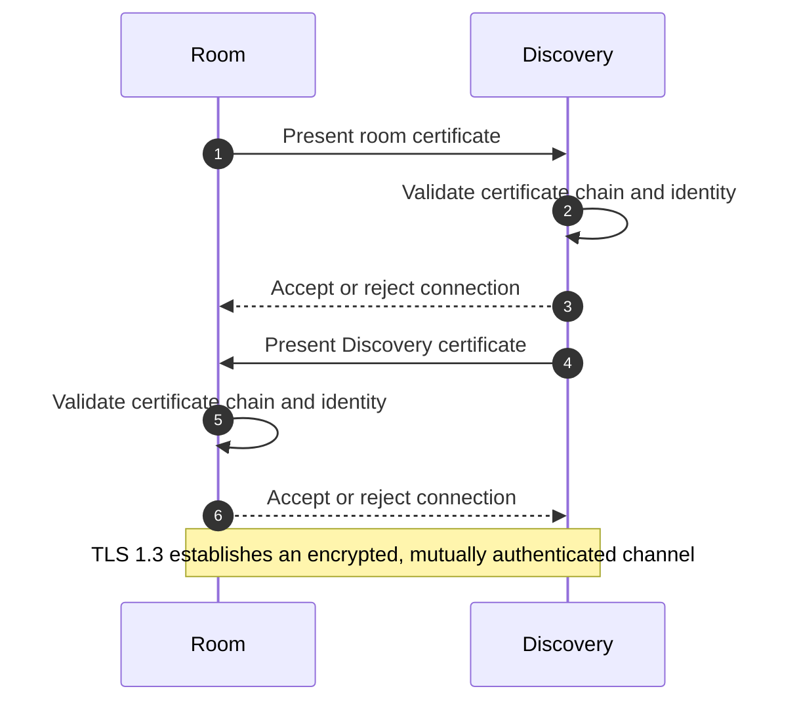
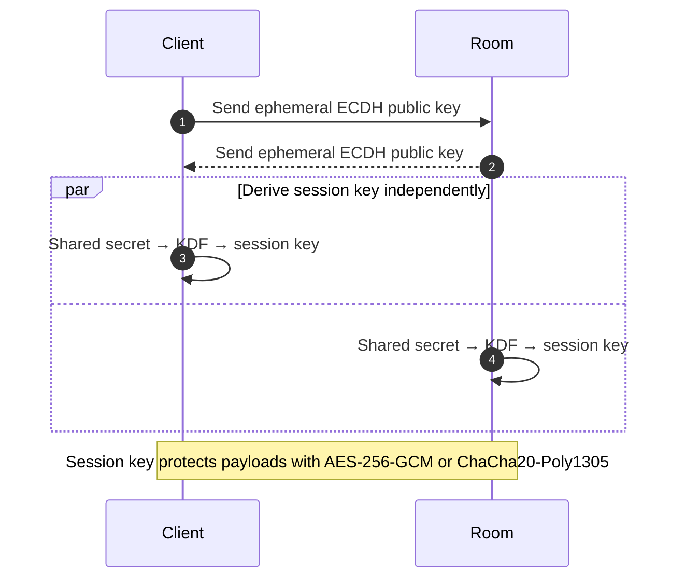
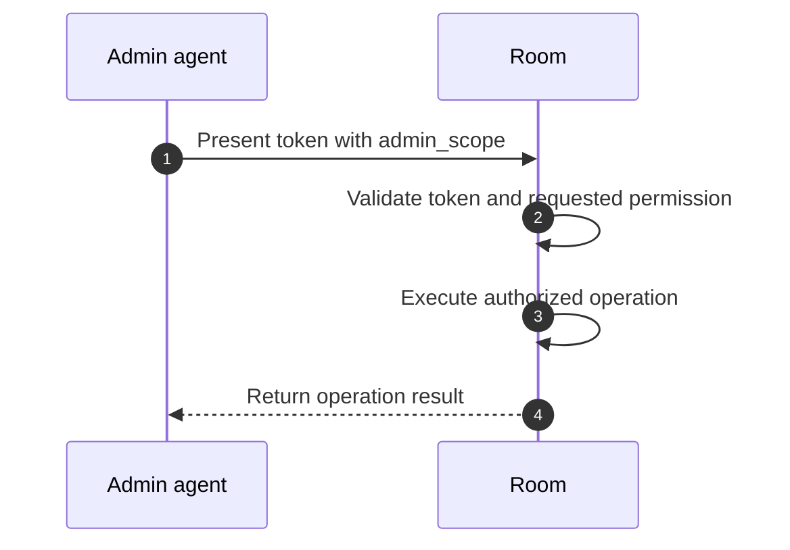

# Security Model

The Open Game Server enforces security in **three independent trust zones**:

## Zone 1: Identity Authentication (IdP ↔ Client)

**What it protects:** verification of who the player is.

**Mechanism:**
- OAuth2 / OIDC, or custom authentication
- Issuance of a **JWT (JSON Web Token)** with the player's claims
- A JWKS (JSON Web Key Set) published for stateless validation

**Flow:**


**Validation:** Discovery validates the JWT by checking its signature against the IdP's JWKS, without keeping any state.

---

## Zone 2: Infrastructure Authentication (Discovery ↔ Room)

**What it protects:** verification that the room is legitimate and authorized.

**Mechanism:**
- **mTLS (Mutual TLS)** with X.509 certificates
- The room holds a certificate signed by an authority that Discovery trusts
- Discovery holds a certificate to authenticate itself to the room

**Flow:**


**Benefits:**
- Both parties guarantee each other's identity
- No pre-shared keys
- Resistant to MITM attacks

**Heartbeat/Lease:**
- The room sends periodic heartbeats to renew its registration
- Discovery validates mTLS on every heartbeat
- Rooms that stop sending heartbeats are removed from the catalog

---

## Zone 3: Session Encryption (Client ↔ Room)

**What it protects:** confidentiality and integrity of all client-room communication.

**Mechanism:**
- **ECDH (Elliptic Curve Diffie-Hellman)** to derive a shared secret
- **AES-256-GCM** or **ChaCha20 + Poly1305** for authenticated encryption

**Flow:**


**Properties:**
- **Ephemeral**: the key exists only for the session and is never reused
- **Forward secrecy**: a future key compromise does not expose past sessions
- **AEAD (Authenticated Encryption)**: detects tampering

---

## Join Ticket Validation

When a client resolves a room through Discovery, it receives a **signed join ticket** containing:

```json
{
  "room_id": "abc123",
  "player_id": "xyz789",
  "ttl_seconds": 300,
  "signature": "HMAC-SHA256(...)"
}
```

**Validation in the room:**
1. Check the TTL (it has not expired)
2. Check the signature against the key shared with Discovery
3. Confirm that `player_id` matches the client's JWT
4. Only after validation, allow the ECDH handshake

**Prevents:**
- Forged tickets
- Reuse of expired tickets
- Identity impersonation

---

## Secure Admin API

Admin agents (Game Masters, bots) authenticate with:

- An **admin token** issued by Discovery or the IdP
- A token that carries an `admin_scope` and specific permissions (kick, pause, and so on)
- Validation of the token by the room before any admin operation runs

**Example:**


---

## Layer Summary

| Layer | Mechanism | Protects Against |
|-------|-----------|------------------|
| **IdP** | JWT + JWKS | Identity impersonation |
| **Discovery↔Room** | mTLS | Fake rooms, MITM within the infrastructure |
| **Client↔Room** | ECDH + AEAD | Eavesdropping, tampering, replay |
| **Join Ticket** | HMAC + TTL | Forged or replayed tickets |

Each layer is independent, so a failure in one does not compromise the others.

Continue to the [End-to-End Flow](end-to-end-flow) to see how all of these validations work together.
