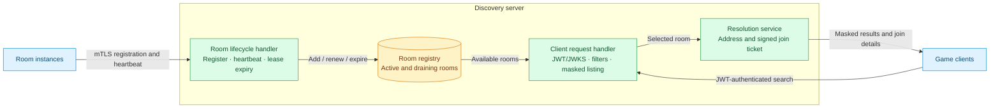
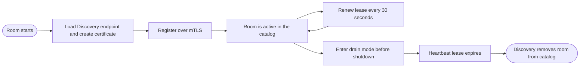
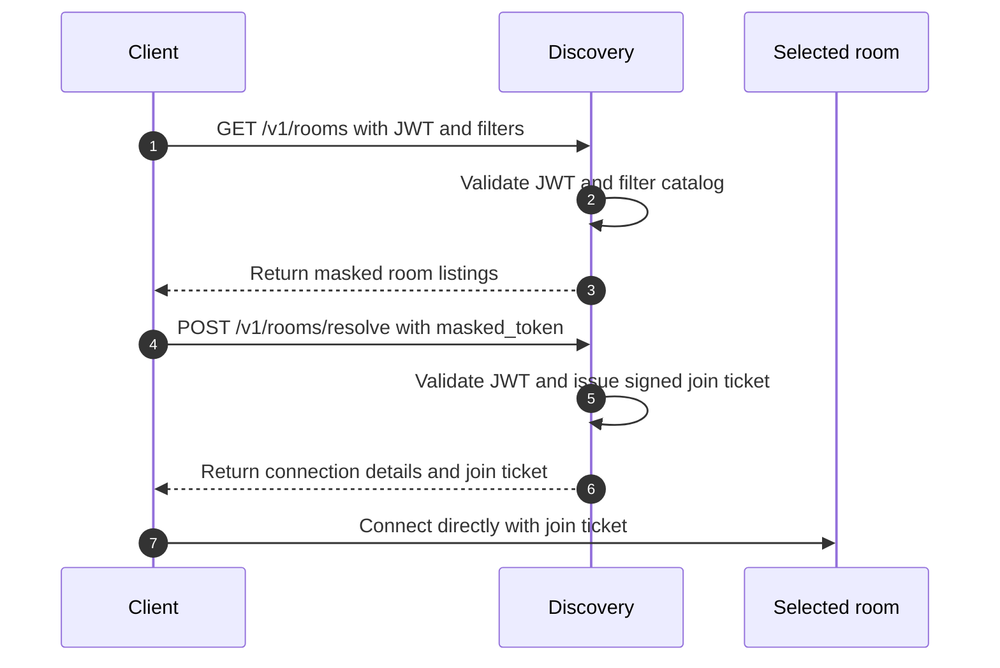

# Discovery Server

The **Discovery Server** (also called the "Discovery") is the central component that aggregates and masks multiplayer rooms.

## Main Responsibilities

1. **Catalog aggregation**: keep an up-to-date registry of all active rooms
2. **Address masking**: hide real IPs and ports during listing
3. **Join ticket issuance**: generate signed credentials so clients can join rooms
4. **mTLS authentication**: validate the identity of registered rooms
5. **JWT validation**: validate client identity against the IdP's JWKS
6. **Filtering and search**: let clients filter rooms by tags (game mode, language, region, and so on)

## High-Level Architecture

## Room Lifecycle

## Main Endpoints

### Client-facing (HTTPS + JWT)

- **`GET /v1/rooms`**: list masked rooms with filters
- **`POST /v1/rooms/resolve`**: resolve the chosen room and issue a join ticket

### Room-facing (HTTPS + mTLS)

- **`POST /v1/discovery/register`**: self-registration of a new room
- **`POST /v1/discovery/heartbeat`**: renew the lease and report state
- **`POST /v1/dns/drain`**: frozen legacy identifier pending Open Decision OD1; do not treat
  `/v1/discovery/drain` as canonical until that decision is recorded

## Discovery Flow

Continue with [Room Registration](room-registration), [Room Listing](room-listing), and [Ticket Resolution](ticket-resolution).
