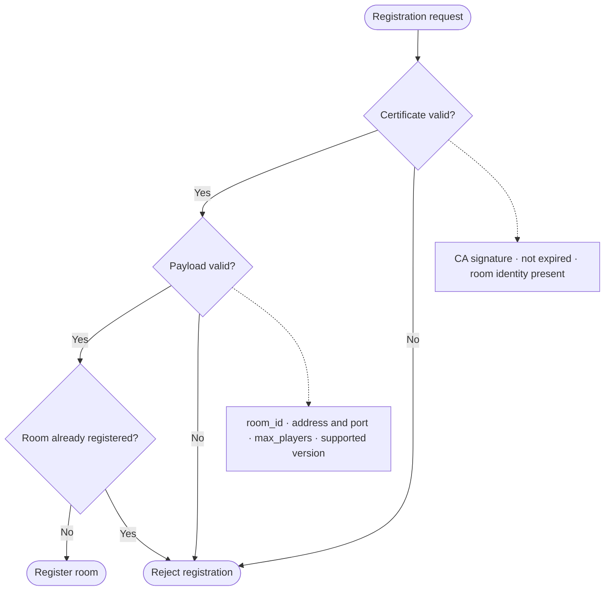

# Room Registration

Each decentralized room performs **self-registration** with the Discovery Server on startup.

## Registration Flow

### 1. Preparation (room side)

On startup, the room:

1. Reads its configuration:
   ```
   DISCOVERY_HOST=discovery.example.com
   DISCOVERY_PORT=443
   ROOM_ID=room-1234
   MAX_PLAYERS=8
   GAME_MODE=race
   REGION=us-east
   ```

2. Generates or loads an X.509 certificate:
   ```
   cert.pem (signed by the trusted CA)
   key.pem (private key)
   ```

3. Generates an ECDH key pair for client-room security:
   ```
   room_private_key (ECDH)
   room_public_key (ECDH), published in the registration
   ```

### 2. Registration Request (mTLS)

```
POST https://discovery.example.com:443/v1/discovery/register
Content-Type: application/json

{
  "room_id": "room-1234",
  "host": "192.168.1.100",
  "port": 9000,
  "protocol": "wss",
  "max_players": 8,
  "current_players": 0,
  "game_mode": "race",
  "region": "us-east",
  "language": "en-US",
  "version": "1.0.0",
  "public_key_ecdh": "base64(...)",
  "capabilities": [
    "http",
    "websocket",
    "sse"
  ],
  "tags": {
    "difficulty": "hard",
    "competitive": true
  }
}
```

**Security:**
- The room presents its X.509 client certificate during the TLS handshake.
- The connection uses mTLS: Discovery validates the certificate before processing the request.

### 3. Validation in Discovery



### 4. Success Response

```json
{
  "status": "registered",
  "masked_token": "tok_room_1234",
  "lease_ttl_seconds": 180,
  "heartbeat_interval_seconds": 30,
  "next_heartbeat_due": "2026-10-11T12:00:30Z",
  "server_time": "2026-10-11T12:00:00Z"
}
```

**Fields:**
- `lease_ttl_seconds`: how long the room stays registered without a heartbeat
- `heartbeat_interval_seconds`: recommended heartbeat frequency
- `next_heartbeat_due`: when to send the next heartbeat to avoid a timeout

## Registration Errors

| Code | Reason | Action |
|------|--------|--------|
| `400 Bad Request` | Invalid or incomplete payload | Validate the request |
| `401 Unauthorized` | Invalid or untrusted certificate | Check the certificate and CA |
| `409 Conflict` | Room ID already registered | Use a unique ID or deregister the previous room |
| `413 Payload Too Large` | Payload exceeds the limit | Reduce tags or metadata |
| `503 Service Unavailable` | Discovery is down | Retry with exponential backoff |

## Lease Renewal (Heartbeat)

After a successful registration, the room sends a **periodic heartbeat**:

```
POST https://discovery.example.com:443/v1/discovery/heartbeat
Content-Type: application/json

{
  "masked_token": "tok_room_1234",
  "current_players": 4,
  "game_state": "in_progress",
  "occurred_at": "2026-10-11T12:00:30Z"
}
```

**Purpose:**
- Renew the lease (180 seconds)
- Report the current number of players
- Signal that the room is alive

If a room sends no heartbeat before `lease_ttl_seconds` expires, Discovery removes it from the
catalog.

The separate `/v1/dns/drain` endpoint is a frozen legacy identifier pending canonical naming
decision OD1. The naming contract retains this path until OD1 is recorded; this document does not
resolve that protocol decision.

## Graceful Shutdown (Drain Mode)

Before shutting down, the room enters **drain mode**:

```
POST https://discovery.example.com:443/v1/dns/drain
Content-Type: application/json

{
  "masked_token": "tok_room_1234",
  "reason": "planned_maintenance",
  "drain_time_seconds": 60
}
```

**Effect on Discovery:**
1. The room is marked with the frozen `"drain"` state in the catalog.
2. The listing communicates the room state so clients do not choose it for new matches.
3. The room keeps serving its existing players.
4. After `drain_time_seconds`, the room is removed from the registry.

This flow enables **graceful shutdown** without abrupt interruption.

---

Next: [Room Listing](room-listing)
