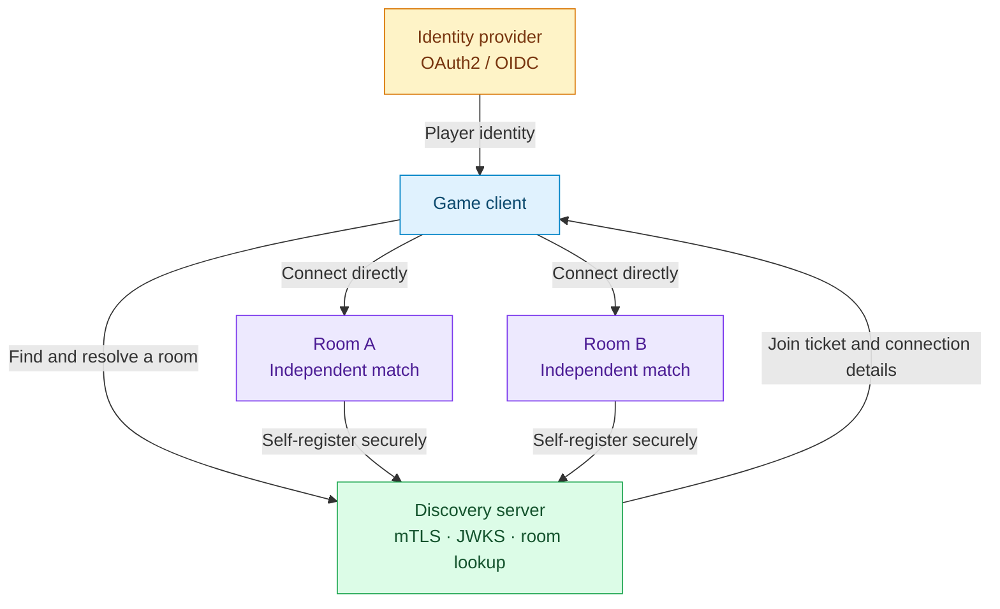

# Motivation and Vision

The **Open Game Server Ecosystem** is an open, standardized, and generic specification for the architecture of multiplayer game servers.

## Goal

Define a standard that is fully agnostic of:
- **Game engine**: Unity, Unreal, Godot, Web, and others
- **Programming language**: Python, Go, Rust, Node.js, C#, and others
- **Infrastructure**: cloud providers, containers, bare metal

## Core Principles

### 1. **Decoupling**
Clearly separate the responsibility of **discovery and masking** (the Discovery Server, the "Discovery") from the **execution of matches** (decentralized room instances).

### 2. **Scalability**
An architecture that can scale from one room to thousands of rooms hosted across many providers or containers, without central bottl_msenecks.

### 3. **Dynamic Security**
A unique encryption key per room, stateless client identity validation through JWT, and mTLS authentication between infrastructure components.

### 4. **Efficiency**
A reactive state schema with smart caching (`_id` and `ttl_ms`), which reduces unnecessary data traffic.

### 5. **Flexibility**
Support for multiple transports (HTTP, WebSockets, SSE) in parallel, or configured for the profile of each game.

## Component Structure

The client gets its credentials from the IdP, resolves rooms through Discovery, and connects directly to the chosen room.

## Next Steps

Read the [Architecture](../architecture/overview) and [Components](../architecture/components) sections to see how these elements relate in depth.
