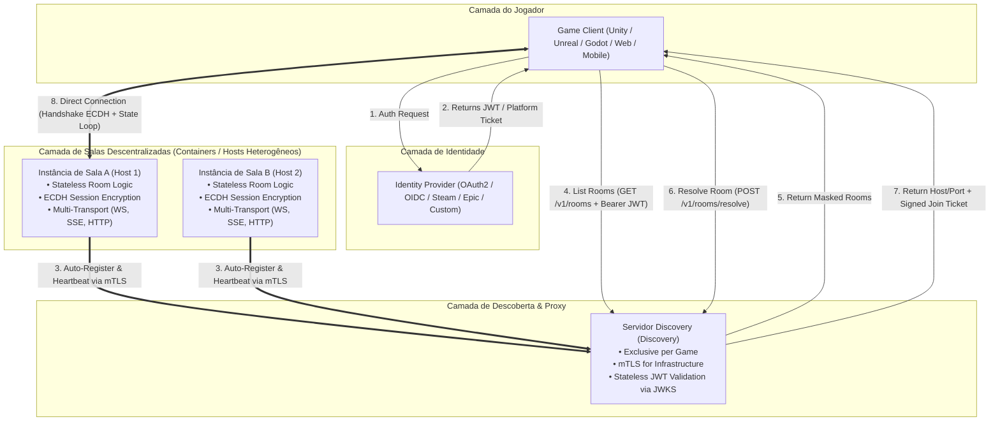
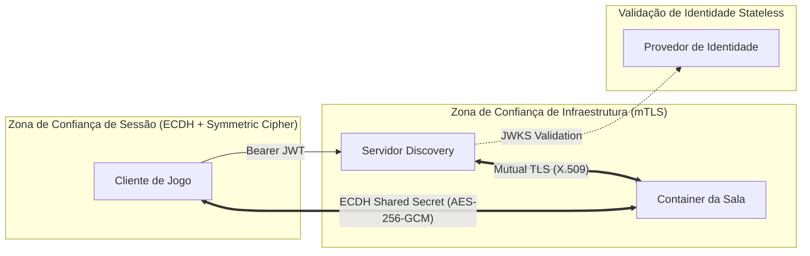

# Especificação Arquitetural Global (Open Game Server Ecosystem)

**Versão da Especificação:** 2026.09.02-1  
**Status:** Especificação Aprovada

## Viability

**Conclusion:** viable with caveats.

- **Technical viability:** the naming standard is a documentation-level protocol cleanup with no runtime effect; compatibility is primarily editorial and can be enforced by repo-wide search and docs build validation.
- **Security and privacy impact:** the renames do not change trust boundaries or cryptographic flows; they reduce ambiguity for clients and operators and improve auditability.
- **Compatibility impact:** the change is breaking for published draft identifiers, but no implementation or live clients exist yet. The migration is a protocol revision only, documented in the PRD and in the canonical identifier table.
- **Effort and complexity:** low complexity because the scope is documentation-only and the canonical mappings are explicit; the main cost is cross-file review and the docs build gate.
- **Rejected alternatives:** keep the old names forever, accept multiple names for the same concept, or defer the standardization until implementation exists. All three would preserve drift and increase integration risk.

---

## 1. Visão Geral do Ecossistema

O **Open Game Server Ecosystem** é uma arquitetura descentralizada, genérica e de alta performance para gerenciamento de salas de jogos multiplayer e descoberta de partidas.

A arquitetura separa claramente as responsabilidades entre **Descoberta/Mascaramento (Servidor Discovery)** e **Execução/Sincronização de Partidas (Instâncias de Salas Descentralizadas)**, garantindo que o jogo possa escalar de 1 a milhares de salas hospedadas em múltiplos provedores ou containers sem gargalos centrais.

---

## 2. Visão Geral da Arquitetura End-to-End

---

## 3. Matriz de Componentes e Responsabilidades

| Componente | Função Principal | Camada de Segurança | Protocolos |
| :--- | :--- | :--- | :--- |
| **Provedor de Identidade (IdP)** | Autenticar a conta do jogador e emitir JWT/Tickets. | OIDC / OAuth2 / Public Key | HTTPS |
| **Servidor Discovery (DNS)** | Agregar catálogo de salas, aplicar tags/filtros, mascarar endereços e emitir tickets de entrada assinados. | mTLS para salas, JWT/JWKS para clientes | HTTPS (mTLS nas rotas `/dns/*`) |
| **Instância da Sala (Container)** | Executar a simulação da partida, validar o ticket de entrada, sincronizar estados reativos (`$.server`, `$.me`, `$.others`). | ECDH Key Exchange + AES-256-GCM / ChaCha20 | WebSockets, SSE, HTTP REST |
| **Cliente de Jogo** | Renderizar o jogo, efetuar ping probing de salas, negociar criptografia e sincronizar inputs do jogador. | Shared Secret derivado por ECDH | WebSockets, SSE, HTTP REST |

---

## 4. Matriz de Segurança e Confiança

---

## 5. Estrutura de Documentação do Projeto

O projeto `open-game-server` é documentado na seguinte estrutura de diretórios em `prd/`:

* [`prd/desejo.md`](file:///home/ohrlando/code/personal/open-game-serger/prd/desejo.md) — Visão executiva inicial, motivação e requisitos primários do sistema.
* [`prd/discovery.md`](file:///home/ohrlando/code/personal/open-game-serger/prd/discovery.md) — Especificação técnica do Servidor Discovery (mTLS, OAuth2, filtros por tags e resolução).
* [`prd/room-protocol.md`](file:///home/ohrlando/code/personal/open-game-serger/prd/room-protocol.md) — Especificação técnica do protocolo da sala (Handshake ECDH, Well-Known, Schemas `$.server`/`$.me`/`$.others`, Caching `_id`/`ttl_ms` e Multi-Transporte).
* [`prd/architecture.md`](file:///home/ohrlando/code/personal/open-game-serger/prd/architecture.md) — Visão arquitetural global do ecossistema e mapeamento de componentes.
