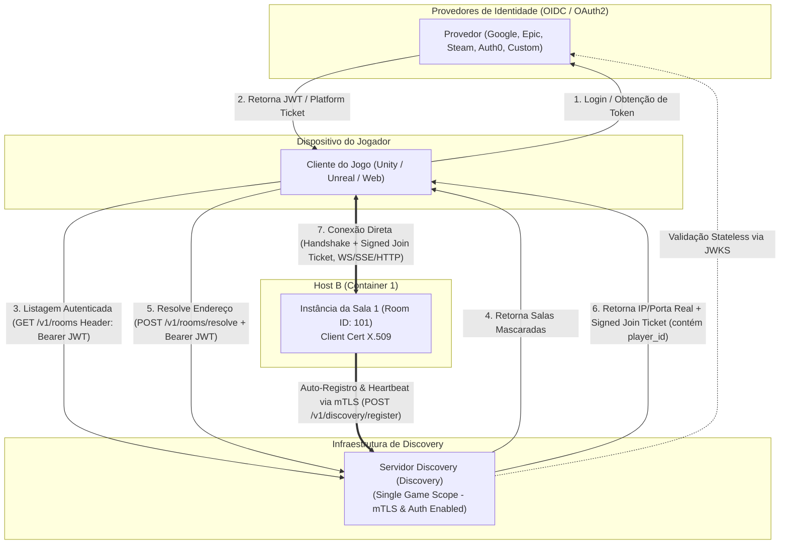
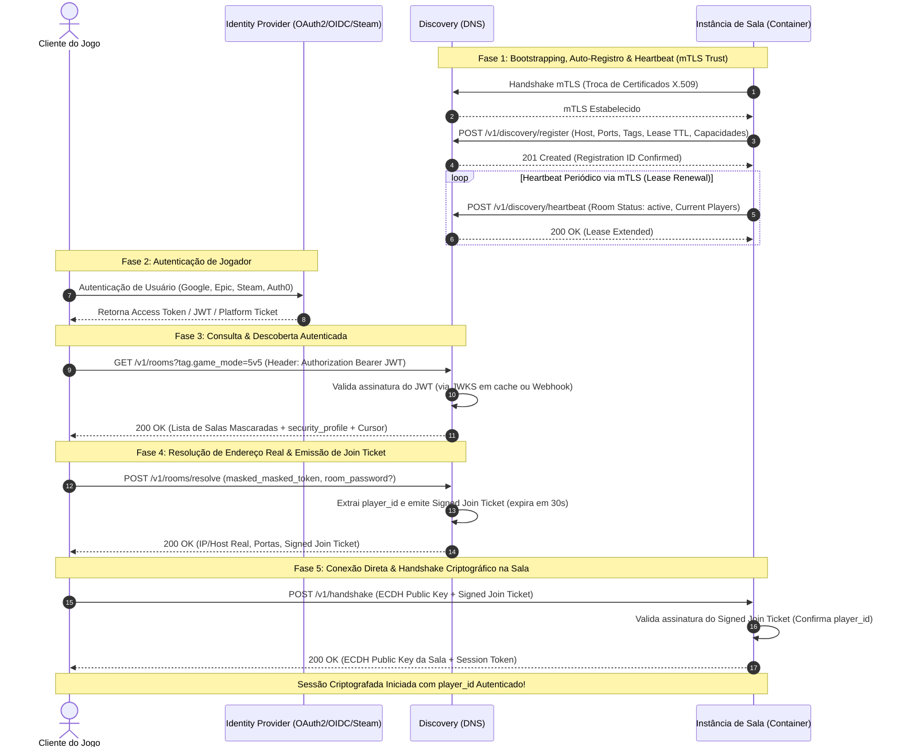

# Especificação do Servidor Discovery (Discovery)

**Versão da Especificação:** 2026.09.02-1  
**Escopo:** Servidor Discovery exclusivo por jogo (Single Game Scope).


## Viability

**Conclusion:** viable with caveats.

- **Technical viability:** the naming standard is a documentation-level protocol cleanup with no runtime effect; compatibility is primarily editorial and can be enforced by repo-wide search and docs build validation.
- **Security and privacy impact:** the renames do not change trust boundaries or cryptographic flows; they reduce ambiguity for clients and operators and improve auditability.
- **Compatibility impact:** the change is breaking for published draft identifiers, but no implementation or live clients exist yet. The migration is a protocol revision only, documented in the PRD and in the canonical identifier table.
- **Effort and complexity:** low complexity because the scope is documentation-only and the canonical mappings are explicit; the main cost is cross-file review and the docs build gate.
- **Rejected alternatives:** keep the old names forever, accept multiple names for the same concept, or defer the standardization until implementation exists. All three would preserve drift and increase integration risk.

---

## 1. Visão Geral

O **Servidor Discovery (Discovery)** é o componente responsável por agregar, catalogar, monitorar a saúde e mascarar o acesso a todas as instâncias descentralizadas de salas de um jogo. 

Uma única instância do Discovery atende a um jogo específico. Ele atua como o ponto de entrada primário do cliente de jogo para descoberta de partidas, resolução de conexões diretas e negociação de capacidades.

### 1.1. Arquitetura Geral de Comunicação

O ecossistema é composto por quatro componentes principais:
- **Cliente (Game Engine / App):** Autentica-se em um Provedor de Identidade, consome o Discovery para encontrar partidas e conecta-se diretamente à Sala resolvida.
- **Provedores de Identidade (OIDC / OAuth2 / Plataformas):** Provedores externos (Google, Epic Games, Apple, Steam, Auth0) que emitem as credenciais de jogador.
- **Servidor Discovery (Discovery):** Agregador e proxy reverso de metadados, validando a autenticação do cliente de forma stateless (JWKS/Webhook) e mantendo o catálogo atualizado via **mTLS com as salas**.
- **Instâncias de Salas (Containers / Hosts Heterogêneos):** Processos autônomos que hospedam partidas, registram-se no Discovery via mTLS e recebem a identidade validada do jogador.



### 1.2. Diagrama de Sequência de Comunicação

O diagrama abaixo detalha a cronologia completa desde o boot da sala (com loop de heartbeat) e login do jogador até a entrada autenticada na sala:



---

## 2. Big Features & Recursos do Discovery

### 2.1. Auto-Registro com Lease & Heartbeat Reverso
- **Auto-Registro no Boot:** Durante a inicialização/deploy do container da sala, o processo lê parâmetros de ambiente (URL do DNS, certificados mTLS) e efetua o auto-registro (`POST /v1/discovery/register`).
- **Mecanismo de Lease (TTL):** A sala recebe um tempo de vida do registro (`lease_ttl_ms_seconds`). Ela precisa enviar pings de atualização (`POST /v1/discovery/heartbeat`) periodicamente. Se o DNS não receber o heartbeat dentro do tempo de lease, a sala é removida do catálogo automaticamente.
- **Graceful Shutdown (Drain Mode):** A sala pode sinalizar que está finalizando a partida alterando seu estado para `drain`. O DNS mantém a sala listada apenas para os jogadores atuais e impede a entrada de novos clientes.

### 2.2. Listagem Filtrável por Tags & Metadados do Jogo
- **Escopo Exclusivo de Jogo:** Embora o Discovery seja dedicado a um único jogo, o jogo pode ter múltiplos modos, mapas e versões.
- **Suporte a Tags Flexíveis:** No auto-registro, a sala publica suas tags (ex: `game_mode: "5v5"`, `map: "desert_01"`, `version: "1.4.0"`, `access_type: "public"`).
- **Consulta Filtrada:** O cliente pode consultar o catálogo aplicando filtros dinâmicos via parâmetros de busca (ex: `GET /v1/rooms?tag.game_mode=5v5&tag.map=desert_01`).

### 2.3. Geo-Routing & Metadados de Latência
- **Probing de Latência:** As salas informam a região em que estão hospedadas (ex: `sa-east-1`, `us-east-1`) e, opcionalmente, um host/IP para teste de ping rápido (*latency probing*).
- **Ordenação por Proximidade:** O cliente de jogo pode solicitar a lista de salas ordenando por menor latência estimada ou por proximidade geográfica.

### 2.4. Matriz de Capacidades e Transportes (Capability Negotiation)
- **Anúncio de Transportes:** O Discovery expõe quais modalidades de transporte cada sala suporta:
  - `websocket` (Bidirecional / Tempo Real)
  - `sse` (Server-Sent Events)
  - `http` (REST / Long-Polling)
- **Formatos de Serialização:** A lista de salas informa os formatos de payloads aceitos (`json`, `protobuf`, `cbor`, `flatbuffers`), permitindo que clientes mais antigos ou em plataformas limitadas conectem-se utilizando os transportes e serializações suportados.

### 2.5. Controle de Acesso e Mascaramento (Proxy Masking & Resolution)
- **Mascaramento Inicial:** Na listagem pública de salas (`GET /v1/rooms`), os endereços IP e portas reais dos containers não são expostos diretamente. É retornado um `masked_token`.
- **Resolução de Conexão (`POST /v1/rooms/resolve`):** O cliente envia o `masked_token` (e, se aplicável, a senha de sala privada). O Discovery valida a permissão e retorna os dados reais de conexão (IP/Hostname e porta) acompanhados do `Signed Join Ticket`.

### 2.6. Relação de Confiança de Infraestrutura (mTLS entre Salas e Discovery)
- **Mutual TLS (mTLS):** A comunicação administrativa entre as salas e o Servidor Discovery (`/v1/discovery/*`) é protegida obrigatoriamente por mTLS.
- **Validação de Certificado X.509:** Tanto a sala quanto o Discovery apresentam certificados digitais válidos emitidos pela autoridade certificadora (CA) interna do cluster/jogo.
- **Prevenção de Injeção Maliciosa:** Impede estritamente que nós maliciosos, containers não autorizados ou agentes externos injetem salas falsas ou forjem heartbeats no catálogo do Discovery.

### 2.7. Autenticação de Cliente & Suporte a Provedores Federados (OAuth2 / OIDC / Adaptadores)
- **Suporte Nativo a OpenID Connect (OIDC / OAuth2):** O Discovery pode ser configurado para validar JWTs emitidos por qualquer provedor OIDC padrão (ex: Google, Epic Games Store, Apple, Auth0, Keycloak, Firebase). A validação é feita de forma **stateless** via URLs de JWKS (`.well-known/jwks.json`), sem necessidade de banco de dados no Discovery.
- **Adaptadores de Plataforma (Steam, EA, Custom Auth):** Para plataformas que utilizam tickets proprietários em vez de JWT (como o Steam Auth Session Ticket), o Discovery suporta a delegação de validação para um **Auth Verification Webhook** leve ou o uso de bibliotecas de verificação nativas da plataforma.
- **Propagação de Identidade Assinada (Signed Join Ticket):** Ao autorizar uma resolução de sala (`/resolve`), o Discovery emite um `Signed Join Ticket` assinado com a chave do cluster contendo o `player_id` extraído do token do jogador. A sala valida matematicamente a identidade do jogador no handshake.

### 2.8. Resource Discovery do DNS (`/.well-known/game-discovery`)
- **Auto-Configuração do SDK/Cliente:** Assim como as salas possuem seu well-known, o Servidor Discovery expõe um endpoint público unificado `GET /.well-known/game-discovery`.
- **Conteúdo Exposto:**
  - `spec_version`: Versão da especificação suportada pelo DNS (ex: `2026.09.02-1`).
  - `api_versions`: Lista de versões da API suportadas (ex: `["v1"]`).
  - `game_id`: Identificador único do jogo atendido por esta instância do DNS.
  - `auth`: Modos de autenticação ativos (`none`, `bearer_jwt`, `platform_ticket`), emissores OIDC aceitos e URL dos JWKS.
  - `query_tags`: Lista de tags suportadas para filtros de busca de salas (ex: `["game_mode", "map", "region", "version"]`).
  - `endpoints`: Mapeamento explícito das URLs `/v1/rooms`, `/v1/rooms/resolve` e `/v1/discovery/register`.

#### Exemplo de Resposta de `GET /.well-known/game-discovery`:

```json
{
  "spec_version": "2026.09.02-1",
  "api_versions": ["v1"],
  "game_id": "cyber_arena_2026",
  "auth": {
    "mode": "bearer_jwt",
    "accepted_issuers": ["https://accounts.google.com", "https://api.epicgames.dev"],
    "jwks_urls": ["https://accounts.google.com/.well-known/openid-configuration/jwks"]
  },
  "query_tags": ["game_mode", "map", "region", "version"],
  "endpoints": {
    "rooms_list": "/v1/rooms",
    "rooms_resolve": "/v1/rooms/resolve",
    "discovery_register_endpoint": "/v1/discovery/register"
  }
}
```

### 2.9. Paginação por Cursor, Rate Limiting e Schema de Resposta de Salas
- **Paginação Transparente por Cursor:** A listagem pública `GET /v1/rooms` aceita os parâmetros `cursor` (string opaca contendo o marcador da página) e `limit` (padrão: 50, máximo: 100). A resposta inclui o campo `next_cursor`.
- **Exposição do Perfil de Segurança da Sala:** Cada sala retornada na lista informa antecipadamente o seu `security_profile` (`strict_per_packet` ou `optimistic_session`), permitindo que o cliente prepare seu pipeline criptográfico antes mesmo de realizar o handshake.
- **Rate Limiting de Proteção:** Requisições de clientes no DNS são limitadas por `player_id` (ou IP em caso de auth anônima). Exceder o limite resulta em resposta `429 Too Many Requests` com o header `Retry-After`.

#### Schema Completo de Resposta do `GET /v1/rooms`:

```json
{
  "rooms": [
    {
      "masked_token": "tok_sa_east_90412",
      "tags": {
        "game_mode": "5v5",
        "map": "desert_01",
        "version": "1.4.0"
      },
      "region": "sa-east-1",
      "ping_host": "ping.sa-east-1.mygame.com",
      "current_players": 4,
      "max_players": 10,
      "status": "active",
      "security_profile": "optimistic_session",
      "transports": ["websocket", "sse"],
      "codecs": ["json", "protobuf"]
    }
  ],
  "next_cursor": "eyJpZCI6MTAyfQ=="
}
```

### 2.10. Webhooks de Eventos de Lifecycle de Salas (Notificações Pub/Sub)
- **Notificação Assíncrona para Orquestradores:** O DNS suporta o envio de webhooks HTTP POST para URLs externas configuradas (ex: orquestrador de frota de containers, motor de matchmaking ou painel de analytics) quando ocorrem eventos no ciclo de vida de qualquer sala.
- **Garantia de Autenticidade:** Cada payload enviado pelo webhook contém a assinatura no cabeçalho `X-Discovery-Signature: sha256=<hmac_hash>` gerada com a chave secreta compartilhada de webhook.

#### Eventos Suportados e Payloads:

1. **`room.registered`** — Disparado imediatamente após uma nova sala concluir seu auto-registro mTLS.
```json
{
  "event": "room.registered",
  "occurred_at": "2026-09-02T18:00:00Z",
  "masked_token": "tok_room_sa_east_104",
  "tags": { "game_mode": "5v5", "map": "desert_01" },
  "region": "sa-east-1",
  "max_players": 10
}
```

2. **`room.status_changed`** — Disparado quando a sala altera seu estado interno (ex: de `active` para `drain` ou `in_progress`).
```json
{
  "event": "room.status_changed",
  "occurred_at": "2026-09-02T18:05:00Z",
  "masked_token": "tok_room_sa_east_104",
  "old_status": "active",
  "new_status": "drain",
  "current_players": 10
}
```

3. **`room.expired`** — Disparado quando a sala é expurgada do catálogo devido a timeout do lease TTL sem heartbeat.
```json
{
  "event": "room.expired",
  "occurred_at": "2026-09-02T18:10:00Z",
  "masked_token": "tok_room_sa_east_104",
  "reason": "LEASE_TTL_TIMEOUT"
}
```

---

## 3. Especificação Sucinta de Regras de Negócio do Discovery

1. **RN-DISC-01 (Isolamento de Jogo):** Cada instância do Discovery é exclusiva para um único jogo. Não há mistura de catálogo entre jogos diferentes.
2. **RN-DISC-02 (Expiração por Timeout):** Se o heartbeat da sala falhar por um período superior a `lease_ttl_ms`, o Discovery deve expirar a sala e expurgá-la do catálogo público imediatamente.
3. **RN-DISC-03 (Proteção de Endereço Real):** O IP/Porta real da sala só pode ser entregue ao cliente após a chamada bem-sucedida do endpoint de resolução (`/resolve`).
4. **RN-DISC-04 (Filtragem Estrita de Tags):** As buscas por tags devem aceitar combinações lógicas (AND) para permitir que o cliente encontre exatamente a sala correspondente ao seu modo e versão de jogo.
5. **RN-DISC-05 (Notificação de Capacidades):** O Discovery não deve retornar salas cujas versões de especificação ou transportes sejam incompatíveis com os parâmetros mínimos solicitados pelo cliente.
6. **RN-DISC-06 (Autenticação mTLS de Infraestrutura):** Todos os endpoints administrativos de gerenciamento de salas (`/v1/discovery/*`) exigem autenticação mTLS obrigatória com certificados de infraestrutura confiáveis. Requisições sem mTLS válido devem ser rejeitadas com `403 Forbidden` / `401 Unauthorized` na camada TLS.
7. **RN-DISC-07 (Autenticação de Cliente Stateless):** Quando `auth_mode` for diferente de `none`, todas as chamadas de consulta (`/v1/rooms`) e resolução (`/v1/rooms/resolve`) devem apresentar um token de autenticação válido no cabeçalho `Authorization: Bearer <token>` ou `X-Platform-Ticket`.
8. **RN-DISC-08 (Geração de Ticket de Entrada Assinado):** O endpoint de resolução de salas deve injetar o `player_id` validado e assinar o `Signed Join Ticket` temporário com um segredo/chave da infraestrutura antes de retorná-lo ao cliente.
9. **RN-DISC-09 (Resource Discovery `/.well-known/game-discovery`):** O DNS deve responder a chamadas `GET /.well-known/game-discovery` de forma pública e sem autenticação para permitir a auto-configuração de SDKs de clientes e salas.
10. **RN-DISC-10 (Rate Limiting de Proteção):** O DNS deve aplicar limitação de taxa de requisições por `player_id`/IP no catálogo público. Exceder o limite deve retornar status `429 Too Many Requests`.
11. **RN-DISC-11 (Paginação por Cursor & Exposição de Perfil):** O endpoint `GET /v1/rooms` deve aceitar busca paginada por cursor (`cursor`, `limit`) e obrigatoriamente expor o `security_profile` de cada sala listada.

---

## 4. Resumo Técnico de Endpoints do Ecossistema

### 4.1. Endpoints de Discovery do DNS (Público / Auto-Configuração):
* `GET /.well-known/game-discovery` — Auto-descrição das capacidades do DNS, versão da spec, versões da API (`api_versions`), modos de auth e tags disponíveis. *(Público)*

### 4.2. Endpoints do Discovery (Uso Exclusivo de Instâncias de Salas - mTLS):
* `POST /v1/discovery/register` — Auto-registro da sala no boot (tags, capacidades, lease TTL). *(Requer mTLS)*
* `POST /v1/discovery/heartbeat` — Renovação do lease e envio de métricas de uso/jogadores ativas. *(Requer mTLS)*
* `DELETE /v1/discovery/unregister` — Encerramento voluntário da sala no catálogo. *(Requer mTLS)*

### 4.3. Endpoints do Discovery (Clientes de Jogo - HTTPS / Bearer Token):
* `GET /v1/rooms` — Consulta pública de salas mascaradas, filtráveis por `tags`, `region` e `transport`, paginada por `cursor` e `limit`. Retorna `security_profile` das salas. *(Requer Bearer Token JWT / Platform Ticket)*
* `POST /v1/rooms/resolve` — Troca do `masked_masked_token` (e `room_password?` se privada) pelos dados de conexão direta (Host/IP/Porta) e `Signed Join Ticket`. *(Requer Bearer Token JWT / Platform Ticket)*

### 4.4. Endpoints Diretos da Sala de Jogo (Conexão Direta Cliente <-> Sala):
* `GET /.well-known/game-room` — Auto-descrição de capacidades da sala, versão da spec, transportes aceitos (WS, SSE, HTTP), perfil de segurança e algoritmo de criptografia. *(Público/Direto)*
* `POST /v1/handshake` — Validação do `Signed Join Ticket` enviado pelo cliente + Troca de chaves ECDH efêmeras (X25519) e semente `totp_seed`. *(Requer Signed Join Ticket)*
* `GET /v1/schema` — Obtenção dos schemas e mapeamentos dos dicionários de estado (`$.server`, `$.me`, `$.others`). *(Cifrado com Chave de Sessão)*
* `GET/POST/WS /v1/ws` (ou `/v1/state`) — Loop de sincronização de estado reativo e envio de inputs via WebSocket, SSE ou HTTP REST respeitando as regras de `_id`, `ttl_ms` e `X-Rolling-Code`. *(Cifrado com Chave de Sessão)*


