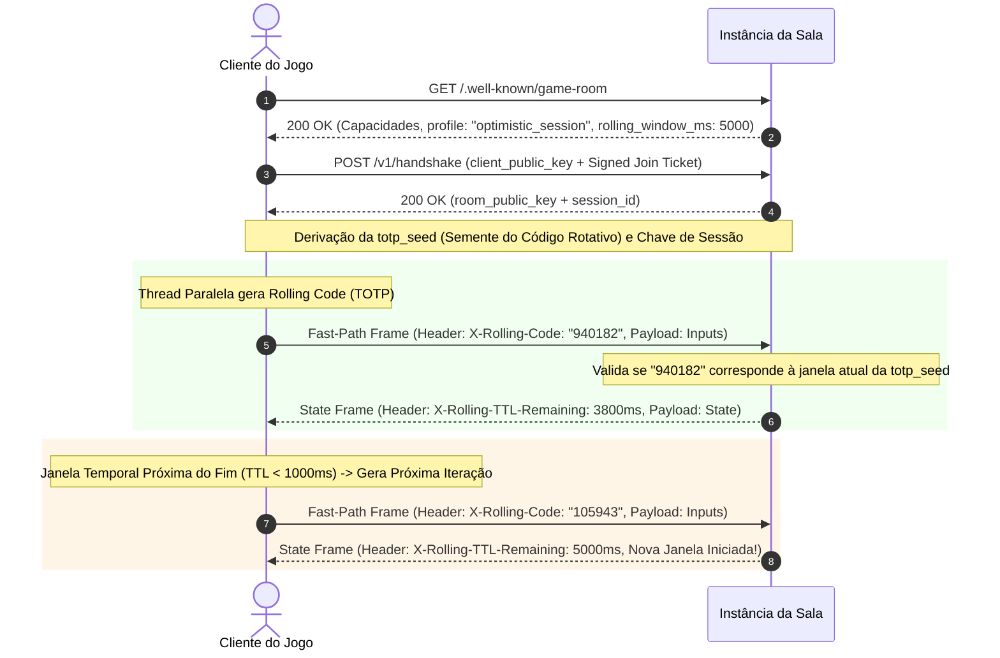
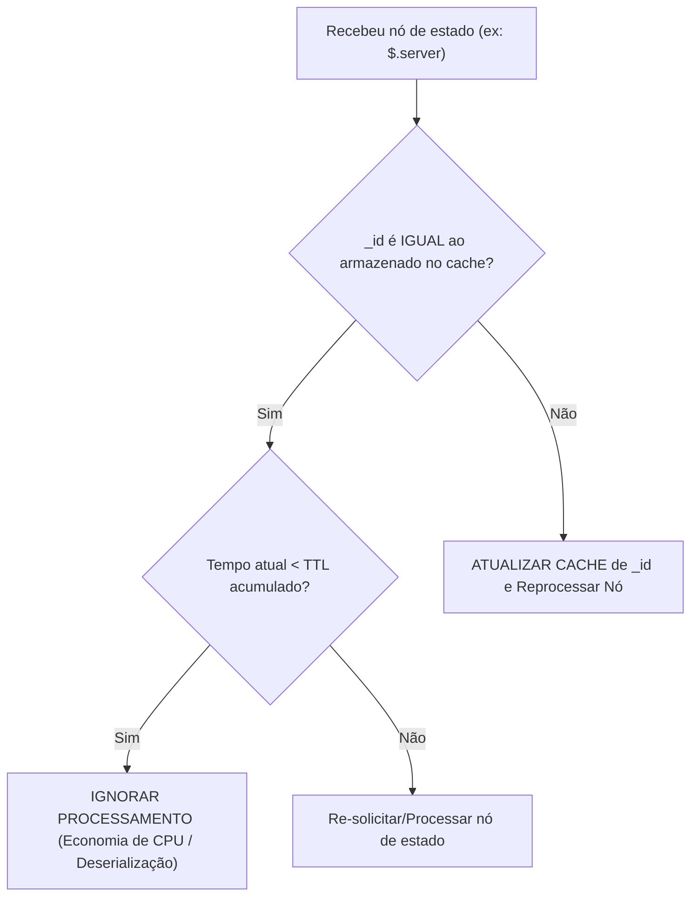

# Especificação do Protocolo de Sala (Game Room Protocol)

**Versão da Especificação:** 2026.09.02-1  
**Escopo:** Comunicação direta entre Cliente de Jogo e Instâncias de Salas Autônomas.

---

## 1. Visão Geral

O **Game Room Protocol** define os padrões de comunicação, segurança e sincronização de estado executados diretamente entre o **Cliente do Jogo** e uma **Instância de Sala Autônoma (Container)** após a resolução de endereço realizada pelo Servidor Discovery.

As salas são descentralizadas, autônomas e executam a lógica da partida (ciclo de rodada, limite de jogadores, times, schemas de entradas/saídas).

---

## 2. Resource Discovery da Sala (`/.well-known/game-room`)

Antes de iniciar a negociação de sessão, qualquer cliente ou serviço externo pode realizar um `GET /.well-known/game-room` para descobrir as capacidades ativas da instância da sala, o perfil de segurança exigido e o catálogo de eventos dinâmicos do jogo suportados.

### Exemplo de Resposta do Endpoint Well-Known:

```json
{
  "spec_version": "2026.09.02-1",
  "room_id": "room_sa_east_104",
  "transports": {
    "websocket": "/v1/ws",
    "sse": "/v1/events",
    "http": "/v1/state"
  },
  "supported_codecs": ["json", "protobuf", "cbor"],
  "security": {
    "handshake_endpoint": "/v1/handshake",
    "key_exchange": "ECDH-X25519",
    "symmetric_cipher": "AES-256-GCM",
    "profile": "optimistic_session",
    "revalidation_interval_ms": 5000
  },
  "events": {
    "catalog": [
      "match.started",
      "match.round_ended",
      "match.cancelled",
      "player.eliminated",
      "custom.achievement_unlocked"
    ],
    "subscription_endpoint": "/v1/events/subscribe"
  },
  "admin": {
    "handshake_endpoint": "/v1/admin/handshake"
  },
  "capabilities": {
    "max_players": 10,
    "current_players": 4,
    "tick_rate": 60
  }
}
```

### 2.1. Inscrição Dinâmica de Eventos de Jogo (Webhooks / Event Stream)
- **Descoberta Agnostica:** A sala publica quais eventos de domínio do jogo ela é capaz de emitir (ex: `match.cancelled`, `player.eliminated`, `round.won`).
- **Inscrição de Clientes / Bots / Serviços:** Clientes de jogo ou bots (ex: bot de Discord, backend de conquistas, orquestrador de torneio) podem se inscrever para receber notificações via Webhook HTTP POST ou via canal de eventos SSE (`/v1/events?filter=match.cancelled`) sem precisar alterar o protocolo core.


---

## 3. Handshake & Criptografia Dinâmica de Sessão

Para garantir que apenas jogadores autorizados e com tickets emitidos pelo Discovery possam interagir com a sala, o cliente deve realizar um **Handshake Criptográfico** usando trocas de chaves efêmeras **ECDH (Elliptic-Curve Diffie-Hellman / Curve25519)**.

### 3.1. Processo de Handshake (Passo a Passo)

1. **Envio do Ticket & Chave Pública do Cliente (`POST /v1/handshake`):**
   - O cliente gera um par de chaves ECDH temporário (X25519).
   - Envia a chave pública do cliente (`client_public_key`) e o `Signed Join Ticket` obtido anteriormente do Servidor Discovery.

2. **Validação do Ticket pela Sala:**
   - A sala valida a assinatura criptográfica do `Signed Join Ticket` usando a chave pública/segredo da infraestrutura.
   - Extrai o `player_id` autenticado do ticket e confirma que o ticket não expirou (máximo de 30s de validade).

3. **Resposta da Sala:**
   - A sala gera seu próprio par de chaves ECDH temporário (X25519) e retorna sua `room_public_key` e um `session_id`.

4. **Derivação do Segredo Compartilhado (*Shared Secret*):**
   - Tanto a sala quanto o cliente calculam de forma autônoma o segredo compartilhado (ECDH).
   - O segredo é derivado via HKDF (HMAC Key Derivation Function) para formar a **Chave Simétrica de Sessão (AES-256-GCM ou ChaCha20-Poly1305)**.

### 3.2. Perfis de Segurança de Pacotes (Pessimista vs. Otimista)

A especificação aceita dois modos de operação para a troca de pacotes em tempo real, anunciados no `GET /.well-known/game-room`:

#### A. Perfil Pessimista (`strict_per_packet`)
- **Funcionamento:** 100% dos pacotes recebidos ou enviados contêm um vetor de inicialização (Nonce/Sequence Counter) e payload com criptografia AEAD inteira (AES-256-GCM / ChaCha20-Poly1305) com validação de tag MAC por pacote.
- **Foco:** Máxima proteção contra adulteração de memória e injeção de pacotes intermediários.
- **Uso:** Jogos de luta 1v1, partidas ranqueadas competitivas esportivas ou trocas com inventário/moedas.

#### B. Perfil Otimista (`optimistic_session` com Rolling Code TOTP - Alta Performance)
- **Funcionamento:**
  - **Inicialização da Semente no Handshake:** Durante o handshake ECDH, cliente e sala derivam uma semente única `totp_seed` e definem a janela de rotação padrão (`rolling_window_ms`, ex: 5000ms).
  - **Emissão Assíncrona via Piggybacking (Header `X-Rolling-Code`):** Em segundo plano (thread paralela ou timer assíncrono), o cliente gera um código rotativo temporário de 6 a 8 dígitos (baseado em TOTP/HMAC-SHA256). Esse código é enviado anexo aos cabeçalhos normais do pacote de jogo no Fast-Path (`X-Rolling-Code: <token>`), sem interromper a execução da partida nem exigir chamadas HTTP extras.
  - **Feedback do Servidor de Tempo Restante (`X-Rolling-TTL-Remaining`):** A sala responde a cada pacote indicando quanto tempo em milissegundos resta até o código atual expirar (ex: `X-Rolling-TTL-Remaining: 3200ms`). O cliente utiliza essa informação para saber a iteração exata do próximo código sem necessidade de sincronização de relógio perfeita.
  - **Ajuste Dinâmico pelo Servidor:** Se a sala detectar instabilidade ou comportamento suspeito, ela pode responder exigindo a redução da janela (ex: `X-Rolling-Window-Next: 2000ms`), forçando re-validações mais frequentes de forma transparente.
- **Foco:** Mínima latência de CPU, zero chamadas de rede extras e integridade contínua de sessão.
- **Uso:** Jogos de ação em tempo real, Battle Royale, simuladores de corrida, física contínua ou centenas de jogadores simultâneos.




---

## 4. Acordo de Schemas Reativos (`$.server`, `$.me`, `$.others`)

Após o handshake, o cliente consulta o endpoint `GET /v1/schema` para entender como a sala organizará a estrutura de dados da partida.

### 4.1. Estrutura do Dicionário de Estado

Os dados trafegados entre sala e cliente são organizados em nós de escopo raiz:
- `$.server`: Estado global e público do servidor (ex: tempo de jogo, rodada atual, clima, placar).
- `$.me`: Dados específicos enxergados/pertencentes estritamente ao jogador atual (ex: inventário, munição, vida exata, quests ativas).
- `$.others`: Dados filtrados dos demais jogadores na sala (ex: posições espaciais, estados de animação, vida simplificada).

### 4.2. A Regra de Ouro do Caching: Campos `_id` e `ttl`

Todos os objetos na raiz do dicionário de estado **devem conter obrigatoriamente** os seguintes dois atributos:
1. `_id` (string/hash): Identificador único da versão do estado daquele nó. Toda vez que qualquer dado dentro do nó muda, a sala gera um novo `_id`.
2. `ttl` (integer em ms): Tempo de vida em milissegundos durante o qual aquele nó é considerado válido e garantidamente inalterado.

#### Exemplo de Payload de Estado (`GET /v1/state` ou via WebSocket/SSE):

```json
{
  "$.server": {
    "_id": "srv_hash_90412",
    "ttl": 5000,
    "round": 2,
    "phase": "IN_PROGRESS",
    "match_time_seconds": 124.5
  },
  "$.me": {
    "_id": "me_hash_1102",
    "ttl": 100,
    "health": 85,
    "stamina": 100,
    "ammo": 28,
    "position": { "x": 10.5, "y": 0.0, "z": 44.2 }
  },
  "$.others": {
    "_id": "others_hash_4491",
    "ttl": 100,
    "players": [
      { "id": "p_202", "pos": [12.0, 0.0, 40.0], "anim": "RUN" },
      { "id": "p_309", "pos": [5.1, 0.0, 10.2], "anim": "IDLE" }
    ]
  }
}
```

### 4.3. Algoritmo de Processamento Eficiente do Cliente



---

## 5. Suporte a Multi-Transporte Híbrido

A sala expõe 3 modalidades de transporte que podem ser consumidas simultaneamente ou de forma selecionável:

### 5.1. WebSockets (Baixa Latência / Tempo Real)
- Endpoint: `/v1/ws` (exige envio do `session_id` e header de autenticação cifrado).
- Canal bidirecional e binário (JSON, Protobuf ou CBOR cifrados).
- Utilizado para jogos de ação em tempo real (FPS, Racing, Battle Royale).

### 5.2. Server-Sent Events - SSE + HTTP POST (Streaming de Eventos)
- Endpoint PUSH (Server -> Client): `GET /v1/events` (Stream SSE contendo payloads JSON cifrados).
- Endpoint INPUT (Client -> Server): `POST /v1/input` (Comandos de ação do jogador).
- Utilizado para jogos de estratégia, card games, RPGs de turno ou clientes web atrás de proxies restritivos.

### 5.3. HTTP REST / Polling Otimizado (Fallback)
- Endpoint: `GET /v1/state`
- Suporte ao header standard `If-None-Match: "<_id_server>:<_id_me>:<_id_others>"`.
- Se nenhum `_id` tiver mudado e o TTL estiver ativo, a sala responde instantaneamente com `304 Not Modified` sem tráfego de body.

---

## 6. Protocolo de Administração da Sala (Admin API)

As salas suportam conexões de Administradores (Game Masters, Moderadores, ou Serviços de Backend) que possuem privilégios elevados para gerenciar a partida, moderar jogadores e injetar eventos dinâmicos.

### 6.1. Autenticação e Handshake de Administrador
O administrador não se conecta como um jogador comum. Ele utiliza um token especial emitido por um **Terceiro de Confiança (Trusted Third Party)**.
- Esse terceiro de confiança geralmente é o próprio Servidor DNS / Proxy, que possui autoridade sobre o cluster, ou um Identity Provider de Admins específico configurado na sala via variáveis de ambiente (com JWKS).
- **Processo:** O administrador faz um `POST /v1/admin/handshake` enviando o `Signed Admin Ticket` (um JWT assinado pela chave confiável). A sala valida matematicamente a assinatura e concede um `admin_session_id`.

### 6.2. Gerenciamento de Estado da Sala
O administrador pode forçar mudanças no ciclo de vida da sala:
- `POST /v1/admin/state`
- **Payload:** `{"action": "pause" | "resume" | "drain" | "close"}`
- Permite pausar a física do jogo para averiguações ou encerrar a sala abruptamente.

### 6.3. Moderação de Clientes
O administrador pode atuar diretamente sobre os jogadores conectados:
- `DELETE /v1/admin/players/{player_id}`
- **Payload:** `{"reason": "cheating", "ban_duration_seconds": 3600}`
- A sala desconecta o jogador imediatamente (derrubando o socket/sessão ECDH) e avisa o jogador do motivo.

### 6.4. Injeção Dinâmica de Eventos
O administrador pode lançar eventos customizados na partida, interagindo com a lógica do jogo ou com os clientes:
- `POST /v1/admin/events`
- **Exemplo de Payload:** 
  ```json
  {
    "event": "custom.boss_spawned",
    "target": "global",
    "payload": {
      "boss_id": "dragon_01",
      "coordinates": {"x": 100, "y": 0, "z": 50}
    }
  }
  ```
- A sala retransmite esse evento para todos os jogadores (ou jogadores específicos) através de seus streams (WebSocket/SSE).

---

## 7. Especificação das Regras de Negócio da Sala (RN-ROOM)

1. **RN-ROOM-01 (Validação Estrita de Ticket):** A sala não deve aceitar requisições de handshake sem a apresentação de um `Signed Join Ticket` válido emitido pelo Servidor Discovery.
2. **RN-ROOM-02 (Criptografia Dinâmica Obrigatória):** Toda comunicação pós-handshake deve utilizar a chave de sessão derivável por ECDH. Pacotes não cifrados devem ser descartados.
3. **RN-ROOM-03 (Campos Obrigatórios `_id` e `ttl`):** Todos os nós raiz (`$.server`, `$.me`, `$.others`) exportados no estado devem obrigatoriamente incluir os campos `_id` e `ttl`.
4. **RN-ROOM-04 (Isolamento de Dados em `$.me`):** A sala garante que a sub-árvore `$.me` contém apenas dados autorizados para o jogador daquela sessão. Um jogador jamais recebe os dados de `$.me` de outro jogador.
5. **RN-ROOM-05 (Resposta HTTP 304 Not Modified):** No modo HTTP REST, requisições que enviarem hashes de `_id` equivalentes aos hashes atuais do servidor devem ser respondidas com status `304 Not Modified`.
6. **RN-ROOM-06 (Compatibilidade de Transportes):** A sala deve aceitar conexões simultâneas de clientes consumindo via WebSocket, SSE ou HTTP REST, desde que autenticados.
