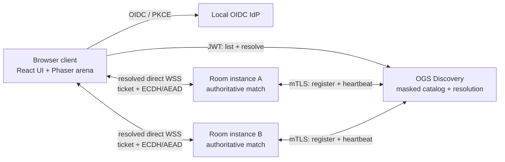

# Implementation Plan: Browser-playable Aimduck sample

**Branch**: `003-aimduck-game` | **Date**: 2026-10-12 | **Spec**: [spec.md](./spec.md)

**Input**: [Feature specification](./spec.md), [playable-sample PRD](../../prd/aimduck-playable-game.md), and the public [Aimduck gameplay/connectivity guide](../../docs/docs/implementation/aimduck.md)

## Summary

Deliver a polished, playable 1v7 browser game under `samples/aimduck/` that doubles as a readable OGS reference implementation. A developer starts one local environment, signs in with a seeded OIDC user, sees masked rooms in Discovery, resolves a room, joins it with a short-lived ticket, and plays an authoritative eight-round match directly against that room. The UI must teach the integration by presenting OGS entities (identity, Discovery, room, ticket, connection) separately from Aimduck state (lobby, seats, roles, rounds, score).

Use a TypeScript workspace with Vite/React for the accessible application shell, Phaser for the 2D arena, a small TypeScript Discovery service, an authoritative TypeScript room process, Keycloak as a local-only OIDC provider, and Docker Compose with at least two fixed room services built from one room image. The room owns simulation, phase transitions, scoring, and broadcast state. The sample follows canonical OGS names and security boundaries, but its explicitly documented sample profile is not a substitute for missing normative protocol details and must not be advertised as a general protocol amendment.

## Technical Context

**Language/Version**: TypeScript 5.x; Node.js 22 LTS for the browser build and services
**Primary Dependencies**: Vite, React, Phaser, `ws` for Node.js WebSockets, Zod for runtime schemas, Keycloak (local OIDC), Docker Engine and Docker Compose v2; Vitest for unit/integration tests and Playwright for browser flows
**Storage**: In-memory Discovery registry and room state; Keycloak development realm storage may be ephemeral; no player profile or match persistence
**Testing**: Formatting/lint/typecheck; domain and physics unit tests; OGS contract tests; Discovery/room integration tests; eight-client Playwright match; Compose smoke and health validation; focused keyboard/accessibility review
**Target Platform**: Current desktop browsers on local Linux, macOS, or Windows hosts running Docker Compose
**Project Type**: Small multi-service browser game sample (web client, Discovery, authoritative room service, local IdP)
**Performance Goals**: Browser playfield renders at 60 fps on a typical desktop; room simulation runs at 30 ticks/s and publishes snapshots at 15 updates/s; local eight-client action-to-authoritative-feedback latency is ≤150 ms p95 on a healthy development host; room input validation does not block the simulation loop
**Constraints**: Eight fixed seats, eight rounds, no more than one active match per room; at least two named room services with unique host ports; browser-visible room addresses must be host-reachable and never Compose-only DNS names; local-only credentials/certificates; JWT/JWKS, mTLS, ticket admission, TLS, and ECDH+AEAD trust boundaries remain distinct; no Docker socket in app containers
**Scale/Scope**: One developer-run Compose project, one browser client, one Discovery service, one local IdP, and two or more fixed room instances; no production scaling, deployment, or public hosting

The selected library versions should be pinned by the sample package manager lockfile. Keep dependencies small and avoid adding a game framework that hides the OGS request/registration/admission lifecycle from readers.

## Constitution Check

**Pre-design gate: PASS WITH RECORDED CAVEATS**

- **PRD first (Principle II)**: [aimduck-playable-game.md](../../prd/aimduck-playable-game.md) exists, covers viability, security/privacy, compatibility, effort, and alternatives, and concludes `viable with caveats`. The earlier [aimduck-example.md](../../prd/aimduck-example.md) remains as the superseded documentation-only PRD.
- **Implementation-independent and testable (Principle III)**: the feature spec describes user-visible behavior. Sample contracts formalize the concrete implementation profile but are explicitly not general OGS requirements. New runtime behavior must remain traceable to requirements and conformance tests.
- **Compatibility and versioning (Principle IV)**: use endpoint and field names from the [canonical identifier contract](../001-standardize-resource-naming/contracts/canonical-identifiers.md). Any required semantic protocol change is a separate versioned decision. Fix directly affected docs in this change rather than creating another source of drift.
- **Secure by default (Principle V)**: player identity uses OIDC/JWT and JWKS validation; room registration/heartbeat uses mTLS; admission tickets are signed, short-lived, and bound to room/player; browser-room communication uses TLS/WSS and the specified ECDH-derived AEAD session. Browser code never possesses an infrastructure certificate or room signing secret. Refer to the trust model in [architecture.md](../../prd/architecture.md).
- **Whole-repository coherence (Principle VI)**: implementation includes a recorded review of PRDs, public docs, `CLAUDE.md`, skills, CI workflows, and constitution where affected. The review step must be represented in the implementation tasks and completed before the feature is declared done.
- **License and quality gates**: confirm all selected dependencies are Apache-2.0 compatible; include `SPDX-License-Identifier: Apache-2.0` in new source files; run the sample's complete test/build gates and the Docusaurus production build if docs change.

**Recorded caveat**: current public handshake/ticket pages are summaries, and some documentation examples differ from the canonical identifiers. The sample may define its own explicit integration profile in `contracts/`, but must neither claim general interoperability nor silently revise OGS semantics. Any unresolvable normative requirement blocks the affected integration behavior and must be raised as a separate protocol decision.

## Research Decisions

- Use React/TypeScript for accessible room browsing, lobby, menus, help, and HUD-adjacent controls; Phaser owns only the rendered arena and game effects.
- Use an authoritative Node.js room with a fixed-step simulation. Clients send intent (movement/aim/throw); they never submit hits, crossings, roles, or score changes.
- Use Keycloak locally with OIDC Authorization Code + PKCE and seeded development identities. Discovery validates JWT signatures and issuer/audience/expiry against JWKS.
- Seed eight distinct local player identities so an eight-client match is possible without account setup or identity reuse.
- Declare fixed `room-1` and `room-2` Compose services (and allow later fixed additions) from one image. They share an internal port but publish distinct host ports. Rooms use Compose DNS to call Discovery but register `localhost` and their distinct published host port for browser clients.
- Generate development CA/certificates and room-scoped secrets locally. Exclude generated material from version control, redact it in logs, and never use it outside this sample.
- Generate distinct local certificates for the Discovery HTTPS endpoint, Discovery's mTLS client identity, and each room's mTLS client identity; mount private material read-only into only the service that needs it.
- Make Discovery's list/resolve/ticket and the direct room handshake visible in source. Do not delegate these responsibilities to a framework's own matchmaking.
- Apply small, explicit game rules and tuneable server-owned constants; document game design tradeoffs in the sample README so the implementation is useful to study, not just a collection of service stubs.

## Teaching Goals and Example Quality

The sample is successful only if a developer can both play it and learn from it. Keep the code path for each concept short enough to trace from browser action to server decision:

1. **Identity**: browser OIDC login returns a player identity; Discovery verifies rather than trusts client claims.
2. **Discovery**: rooms self-register and renew leases; client listing is masked; resolution reveals a reachable endpoint only with a valid player token and issues a ticket.
3. **Admission**: room verifies player/room binding, expiry, and signature before allocating a seat; client-room security is separate from room-Discovery mTLS.
4. **Game authority**: room validates input, simulates world state, resolves hits/crossings, and computes score; clients render snapshots and predict only local movement for responsiveness.
5. **State shape**: show how OGS room state and Aimduck game state map to `$.server`, `$.me`, and `$.others` without confusing game phase with Discovery operational status.
6. **Operations**: a single documented Compose project starts the services; health, registration, restart, lease expiry, and local-only credentials are inspectable.

Every major package should have a concise README or module header explaining its responsibility and its OGS/game boundary. The root sample README should provide a 5-minute quick start, component diagram, source tour, protocol flow, demo accounts, controls, test commands, limitations, and security warning. Keep names and diagrams aligned with code/contracts. Avoid over-abstraction: one room process, one Discovery process, one shared contract package, and a small design-system layer are sufficient.

Keep this end-to-end diagram visible in the sample README and source tour:



Discovery is the player's entry point for finding/authorizing a room, not a gameplay proxy. After resolution, the browser connects to the selected room directly. The diagram, Compose network, code, and contracts must all preserve that distinction.

## Player Experience and Game Design

### Screen and navigation flow

1. **Welcome / identity**: explain that this is an OGS sample; show signed-in identity and a clear sign-in/out path. Never display access tokens or ticket values.
2. **Room browser**: display room name, occupied/max seats, OGS operational status, and game mode; provide refresh, loading, empty, stale-listing, full-room, resolve, and network-error states. Keep actual host/port out of each listing card.
3. **Admission**: show the selected room and explicit connection progress (resolving → ticket received → secure handshake → admitted). On rejection, explain the next safe action (refresh/re-resolve/sign in again) without exposing credentials or cryptographic detail.
4. **Lobby**: show eight stable seat positions, player names/connection, ready status, local player's seat, and a single ready toggle. Explain the start condition. A disconnected seat is visibly reserved with a countdown, not silently removed.
5. **Match**: keep the arena dominant; provide role-specific control instructions, round/time status, local role indicator, accessible score list, event feedback, and pause/leave confirmation. Do not cover active play with decorative OGS diagnostics.
6. **Round result / match result**: communicate hit/crossing outcomes, points awarded, next Shooter, accumulated standings, and final winner/tie; provide a clear return-to-lobby action only when the room lifecycle permits it.

The normal player path should not require understanding protocol jargon. A collapsible “OGS connection details” panel should teach the OGS entities and expose safe diagnostic metadata (masked room ID, transport, connection state, advertised protocol version) but never tickets, keys, JWTs, internal service names, or private addresses.

### Design-system architecture

Organize component APIs by entity and shared state semantics, not by one-off screen styles:

- **Foundation**: semantic color/status tokens, spacing, typography, focus rings, motion preferences, responsive breakpoints, icon conventions, and reduced-motion behavior.
- **Primitives**: buttons, icon buttons, badges, progress indicators, alerts, dialogs, inputs, cards, tabs, and empty/loading/error states with keyboard and screen-reader behavior.
- **OGS entity components**: `PlayerIdentityCard`, `DiscoveryRoomCard`, `RoomOperationalStatus`, `ResolutionProgress`, `JoinStatus`, `RoomConnectionStatus`, and a safe `OgsDetailsPanel`.
- **Aimduck entity components**: `LobbySeatCard`, `ReadinessControl`, `RoleBadge`, `RoundStatus`, `ScoreRow`, `Scoreboard`, and `MatchResult`.
- **Game presentation**: Phaser arena scene, projectiles, collision/score effects, local-player emphasis, and HUD data adapter. React remains the owner of surrounding DOM and accessible controls.

Use text labels and icons in addition to color; maintain visible focus, predictable tab order, sufficient contrast, descriptive button names, and non-color event announcements. Respect `prefers-reduced-motion`; provide a readable event log so essential feedback is not canvas-only. Document each entity component's backing data and its states (`loading`, `ready`, `stale`, `error`, etc.). Do not duplicate transport or matchmaking state in the game-domain model.

### Match and round lifecycle

Implement explicit server-owned state transitions:

```text
room: waiting_for_players -> lobby_ready -> in_progress -> complete
round: pending -> countdown -> active -> resolving -> results -> next_round
seat: empty -> occupied_not_ready -> occupied_ready
      occupied_* -> reserved_disconnected -> occupied_not_ready | empty
connection: resolving -> ticket_validated -> secure -> active -> disconnected | rejected
```

- A room has exactly eight seats and accepts no ninth player. Assignment of the last seat must be atomic.
- All eight players must be connected, seated, and ready before the match can start. A readiness toggle is idempotent; departure/unready during lobby recomputes eligibility.
- Provide a short visible countdown before each round so Ducks and Shooter can read their role and controls.
- Rotate Shooter deterministically by stable seat order: each player is Shooter once across eight rounds. Role assignment is sent by the server, never inferred independently by clients.
- Use a readable side-on arena: Ducks start at the left edge and try to reach the safe zone at the right edge; the Shooter stands on a clearly marked central/rear platform. Add two static cover blocks with visible collision outlines so Ducks have meaningful dodge decisions without obscuring projectiles or outcomes.
- Controls: Ducks move with WASD or arrow keys; the Shooter aims with pointer position (keyboard focus mode moves the aim reticle with arrow keys) and throws with click or Space. Touch is not required for v1. Show a role-specific control legend before the countdown.
- The Shooter's rock has visible wind-up, flight arc, shadow/landing cue, and impact feedback. Ducks have readable movement, hit, and crossing animations. Effects must not change server outcomes or conceal hit confirmation.
- Keep physics simple and explainable: server-owned player speed and arena bounds, projectile speed/gravity, collision radius, throw cooldown, one active projectile limit, and swept collision/crossing checks. Each rock has one authoritative trajectory and can hit at most one Duck. Aim prediction is a client visual aid, never a guarantee of hit.
- Use a 35-second server-owned round deadline and a 4-second result/intermission interval as initial balancing defaults. At deadline, unresolved Ducks remain uncrossed/unhit and the round resolves without awarding either outcome; then the next round proceeds. Constants live in one server-owned tuning module, are deterministic in tests, and may be adjusted only through recorded playtest evidence.
- Award three points to the Shooter for each Duck hit and one point to each Duck that crosses. A hit Duck is eliminated for the rest of the current round; a crossing Duck is safe. Round ends when all seven have an outcome or the deadline is reached.
- After a brief result view, start the next round automatically with a visible countdown; after round 8, freeze gameplay and show final standings and all tied winners.
- Apply server-side input cadence, world-boundary, player-ownership, projectile-count, and action-phase checks. Invalid actions do not mutate state; repeated abuse may close the connection and is recorded without sensitive payloads.
- A lobby disconnect reserves the seat for 30 seconds for the same identity. On return, restore that seat as not-ready and require explicit readiness again. In-match disconnect recovery is not guaranteed; the room follows the match timeout/resolution policy and reports the state to remaining players.
- A room restart loses the in-memory match. It must stop advertising a stale lease, re-register as a new/empty lobby after health checks, and never pretend the interrupted match resumed.

These are sample gameplay rules, not general OGS policy. The implementation must make the timer, cooldown, physics constants, and status transitions deterministic in tests while keeping numeric tuning values in one documented server-owned configuration.

### Feel and usability targets

- A new player can identify their role, objective, movement/throw controls, and score rule from the pre-round screen without a separate documentation lookup.
- Input produces immediate local movement/aim feedback; authoritative correction is smooth and does not snap the player visibly during ordinary low-latency local play.
- Every hit, crossing, point award, round transition, disconnect, and match completion has both an in-game visual cue and a concise text/event-log equivalent.
- The Shooter has time to aim and throw repeatedly during the round; Ducks have enough time and space to change direction and use cover. Tune these tradeoffs in playtests, but never tune client-side score authority.
- The game remains understandable with sound muted, reduced motion enabled, keyboard-only input, or without color perception.
- First-time users can join a room, understand readiness, and perform their role's first action without a developer explaining hidden controls.

### Real-time state and presentation

- Run authoritative simulation at 30 Hz with elapsed-time clamping to prevent a long event-loop pause from causing a giant physics step.
- Publish gameplay snapshots at 15 Hz or on critical phase/score changes. Include monotonic room revision/tick information; do not rebroadcast unchanged large state more frequently than needed.
- Send player-specific data (`$.me`) separately from shared room/match data (`$.server`) and other-player views (`$.others`). Filter private connection details from shared state.
- Validate every incoming JSON message against a runtime schema, enforce a maximum payload size, monotonic per-connection sequence numbers, and rate limits. Reject unknown required protocol versions and malformed messages explicitly.
- Interpolate remote positions and projectiles between authoritative snapshots. Local movement prediction may be used for feel, but must reconcile to server state and must never predict score or hits as fact.
- On network loss, freeze or clearly mark stale remote entities, show reconnecting/offline state and a safe lobby retry path, and avoid continuing to display stale state as authoritative.
- Keep canvas rendering at 60 fps where possible; show UI/hit/crossing feedback within the 150 ms local p95 target. Reduced-motion mode should disable nonessential screen shake and particles without changing outcomes.

## OGS Sample Integration Profile

The code must make each OGS boundary inspectable and independently testable:

- **Client → IdP**: OIDC Authorization Code + PKCE; no embedded secret, implicit flow, hand-built JWT, or credential in URL.
- **Client → Discovery**: `Authorization: Bearer`; `GET /v1/rooms` with masked entries only; `POST /v1/rooms/resolve` using `masked_token`; ticket stays in memory. Validate issuer/audience/expiry through JWKS server-side.
- **Room → Discovery**: self-registration and heartbeat after Discovery health; mTLS client identity verified in both directions; lease and drain behavior; no browser client certificate.
- **Client → Room**: resolve supplies host/port/path reachable from browser; browser establishes TLS/WSS; ticket binds player and room; handshake derives session keys using the explicit sample contract; no direct access before ticket validation.
- **Room runtime**: one container process owns one room/match; each instance has a unique ID and room-scoped ticket verification material; graceful shutdown stops admission/drains and expires/removes its Discovery record.
- **Capacity race**: Discovery listings are snapshots and may be stale; room admission is the final atomic capacity check. A competing ninth admission is rejected with a retryable full-room result and cannot overwrite a seat.
- **Discovery catalog**: in-memory, atomic capacity checks, short listing cache in client, bounded filters and pagination only as needed for the sample; invalid token, full room, unknown room, expired ticket, and lease expiry have distinct errors.
- **Browser networking**: CORS allows only configured local origin; room WebSocket validates `Origin`; ports bind to loopback; browser never uses `room-1`/`room-2` Compose DNS.
- **Protocol posture**: match the canonical naming contract. Sample-specific wire details live in [contracts/](./contracts/). If crypto/wire details exceed or conflict with published normative docs, block the claim of protocol conformance and propose the missing protocol decision separately rather than weakening security for a green demo.

## Implementation Boundaries

- `packages/shared/` contains transport-independent TypeScript types, runtime message schemas, public error codes, event names, and sample protocol version. It must not contain UI components, cryptographic secrets, or mutable server state.
- `client/src/features/` owns OIDC bootstrap, Discovery client, room resolution/admission, lobby controls, and match HUD integration. `client/src/components/design-system/` owns accessible primitives/entity views. `client/src/game/` owns Phaser creation, scene lifecycle, input capture, interpolation, and render-only effects.
- `services/discovery/` owns token validation, room registry/leases, masked listing, resolution, ticket issuance/verification metadata, health/readiness, and mTLS registration routes. Use explicit interfaces so catalog behavior can be unit tested without HTTP.
- `services/room/` owns mTLS registration/heartbeat, ticket admission, handshake/session state, seat lifecycle, authoritative simulation, event/snapshot publication, and graceful drain.
- `infra/keycloak/` contains an importable development realm and demo users with no production credentials. `scripts/dev-setup` generates ignored local certificates/secrets idempotently and prints trust/setup instructions.
- Mount each development private key only into its owning service as read-only material; do not copy private keys into Docker image layers or expose them through the client container.
- `tests/unit/` covers pure state/physics/security helpers; `tests/integration/` runs Discovery+room+IdP protocol flows; `tests/e2e/` runs browser flows and the match.
- Dockerfiles use multi-stage builds, non-root runtime users, minimal runtime contents, health checks, graceful signal handling, and no development hot reload in the default Compose profile unless explicitly selected.
- Service logs include correlation/room IDs and state transitions but redact bearer tokens, join tickets, private keys, certificates, and player input payloads.
- Define workspace-root commands: `npm run dev:setup`, `npm run dev:up`, `npm run dev:down`, `npm run lint`, `npm run typecheck`, `npm run test:unit`, `npm run test:integration`, `npm run test:e2e`, `npm run test:compose`, and `npm run build`. Commands forward to their owning workspaces and return nonzero on failure.

## Project Structure

### Documentation (this feature)

```text
specs/003-aimduck-game/
├── plan.md
├── research.md
├── data-model.md
├── quickstart.md
├── contracts/
│   ├── ogs-integration.md
│   ├── room-gameplay-websocket.md
│   └── local-compose.md
├── checklists/requirements.md
└── tasks.md                 # Produced by /speckit-tasks
```

### Source Code (repository root)

```text
samples/aimduck/
├── README.md
├── package.json
├── package-lock.json
├── tsconfig.base.json
├── eslint.config.js
├── vitest.workspace.ts
├── packages/shared/src/{identity,discovery,room,game}/
├── client/
│   ├── package.json
│   ├── index.html
│   └── src/
│       ├── app/
│       ├── components/design-system/{foundation,primitives,ogs,aimduck}/
│       ├── features/{identity,discovery,admission,lobby,match}/
│       ├── game/{scenes,entities,rendering,input}/
│       └── services/{api,room-connection}/
├── services/
│   ├── discovery/{package.json,src/{auth,catalog,registration,resolution,http}/}
│   └── room/{package.json,src/{ogs,game,simulation,transport}/}
├── infra/
│   ├── keycloak/realm-import/
│   └── dev-certs/
├── scripts/dev-setup
├── tests/
│   ├── unit/
│   ├── integration/
│   ├── e2e/
│   └── fixtures/{identities,rooms}/
├── docker-compose.yml
├── Dockerfile.client
├── Dockerfile.discovery
└── Dockerfile.room
```

Generated private materials under `infra/dev-certs/` and local secret files are ignored by Git. The checked-in realm may contain only clearly labeled local demo users and development settings.

**Structure Decision**: Keep all learning and runtime parts under `samples/aimduck/`; use a tiny shared package only for versioned message/type validation shared by client and services. Build one image per app/service and run explicitly named room services from the same room image with distinct host ports and room-scoped configuration. Keep registry, seat, and match state in memory so the educational lifecycle remains visible and restart semantics are explicit. Do not add a database or a Docker-control service.

## Delivery Sequence

The implementation tasks should be grouped into independently demonstrable vertical slices with dependencies:

1. **Reference skeleton and local tooling**: create the npm workspace, lockfile, license headers, shared type/schema package, test/lint/build commands, source-tour README, eight seeded local identities, and generated-secret ignore rules.
2. **Playable local arena without OGS**: implement the server-owned Aimduck domain state machine and pure physics/action resolution; build the Phaser arena and React HUD against deterministic fixtures; validate controls, visual clarity, full round flow, and outcome/score rules with unit tests and an early manual playtest.
3. **Room service**: move authoritative state into the real-time room process; add lobby capacity, ready controls, round sequencing, tick/snapshot transport, admission guards, disconnect reservation, timeout, and restart/drain behavior; prove with integration tests.
4. **Discovery and room registration**: implement authenticated room registration/heartbeat/lease, masked listing, filtering needed by the UI, atomic room resolution, player/room-bound tickets, and distinct browser-reachable host ports; test all success and failure cases.
5. **OIDC and secure admission**: add Keycloak dev realm, PKCE client flow, JWT/JWKS verification, local CA/mTLS setup, TLS endpoints, ticket validation, authenticated ECDH/AEAD handshake, WebSocket session, Origin and message validation; add crypto/contract test vectors and rejection tests before wiring normal play.
6. **End-to-end game UX**: connect UI → Discovery → room → match; add onboarding/control help, loading/error/retry states, interpolation, events, effects, role and round feedback, score/result views, keyboard/reduced-motion support, and safe diagnostics.
7. **Compose and repeatable demo**: implement health/readiness, two named room instances, unique loopback ports, graceful shutdown, log redaction, `up --build --wait`, and the one-time local cert setup. Validate fresh start and service restart.
8. **Quality and learning review**: complete eight-client tests, manual playability/accessibility review, documentation/harness coherence review, docs build, dependency/license review, and source-map from requirements to tests.

Do not begin slices 5-6 by weakening the completed game domain or by adding local-only bypass auth. If protocol ambiguities block secure integration, report and resolve the documented decision separately.

## Test and Acceptance Strategy

### Automated checks

- **Static**: formatter, linter, strict TypeScript check for every workspace package; production client and server builds; dependency license report; secret scan for committed credentials/private keys.
- **Domain unit tests**: seat assignment and atomic last-seat contention; readiness idempotency and start guard; all eight Shooter assignments; legal phase transitions; 30-second reconnect boundary; timer expiry; score formula, tie handling, hit/cross mutual exclusion, and match completion.
- **Simulation unit tests**: deterministic fixed-step movement; arena bounds; projectile launch/cooldown/count; swept collision to prevent fast-projectile tunneling; obstacle collision if obstacles are enabled; Duck crossing detection; timeout outcome; seeded randomness or injected clock/RNG for repeatability.
- **Protocol/contract tests**: valid and invalid OIDC claim validation, JWKS cache/rotation behavior, mTLS rejection, listing masking, resolve error cases, ticket signature/expiry/identity/room binding, handshake transcript/key derivation test vectors, nonce/sequence replay rejection, malformed/oversized message rejection, CORS and WebSocket Origin checks.
- **Integration tests**: Discovery registration, heartbeat lease expiry, room drain, room re-registration after restart, simultaneous resolve for last seat, ticket-only admission, consistent snapshots, disconnect reservation, per-room key separation, and browser-reachable address mapping.
- **Browser end-to-end**: OIDC login; room list has no host/port; resolve and join; ready/unready; eight browser contexts join one room; all ready starts once; actions affect server-authoritative state; each player is Shooter once; hit/cross events award correct points; round timer resolves; final winner/tie and standings agree in all clients; invalid ticket and connection errors provide recovery actions.
- **Compose smoke**: `docker compose config`; fresh `docker compose up --build --wait`; health/readiness for all services; both rooms registered; URLs reachable from host; room restart/lease expiry; clean `docker compose down`; ensure no token/ticket/private key in logs.
- **Accessibility/playability**: automated accessibility checks for DOM screens plus manual keyboard-only run; visible focus and text status; reduced-motion behavior; screen-reader names for controls, seats, scores, and results. Canvas carries no unique actionable information without a DOM equivalent.

### Playability review (manual)

Run at least three complete playtests with eight participants or a repeatable eight-client test harness. Record setup friction, time to understand controls, unfair/unclear hits, dead time, disconnections, and round completion. At least 80% of first-time playtesters should complete their first role action without coaching; every tester should correctly explain why a point was awarded after the result feedback. Tune physics, cooldown, round deadline, and intermission based on observed outcomes; put selected constants and rationale in `samples/aimduck/README.md`. Keep gameplay readable: role and next action are obvious, aim/throw feedback is immediate, hits/crossings are unmistakable, and results can be understood without reading logs.

No tuning may change the stipulated eight seats, eight rounds, role rotation, score formula, or server authority. If playtesting suggests changing these rules, update PRD/spec and acceptance tests before implementation scope changes.

### Exit criteria

- All user stories in [spec.md](./spec.md) have automated or explicitly recorded manual acceptance evidence.
- Eight-client full-match test passes with consistent authoritative state and scoreboard.
- The same command in [quickstart.md](./quickstart.md) starts the complete documented environment from a clean checkout after local certificate setup.
- The OGS path can be followed through the code and contracts without hidden matchmaking shortcuts or trust-zone conflation.
- Sample docs and public OGS docs agree on identifiers, security properties, limitations, controls, and local ports; Docusaurus build succeeds when docs were touched.

## Documentation and Harness Review

Review and update only where affected:

- `samples/aimduck/README.md`: learning goals, architecture diagram, component/source tour, supported OGS profile, controls, gameplay rules/default tunables, setup, tests, troubleshooting, known gaps, and explicit local-only warning.
- `docs/docs/implementation/aimduck.md`: actual browser journey, sample capabilities, gameplay description, controls, OGS entity mapping, and links to sample quick start without internal repository-only paths.
- `docs/docs/implementation/deployment.md`: local Compose demonstration and clear distinction from production deployment.
- Relevant Discovery, room protocol, transport, state, handshake, and security docs: align canonical endpoints/fields and accurately label any unresolved normative protocol details.
- `CLAUDE.md`, `.claude/skills/`, `.github/workflows/`, and `.specify/memory/constitution.md`: check contribution/test instructions, sample CI coverage, dependency/security/license expectations, and governance; update only for a real mismatch.
- PRD, feature spec, plan, contracts, and tests: verify every public claim and requirement has one consistent source and executable/manual evidence.

Record each surface reviewed and the reason for any no-change decision in the implementation PR or final plan update. Do not expose internal PRD/spec/harness references on public docs pages.

## Post-Design Constitution Check

**Post-design gate: PASS WITH RECORDED CAVEATS**

- The implementation remains one bounded sample with no database, controller, production deployment, or protocol-wide refactor.
- Sample contracts are explicitly scoped and testable; a wire-level contract with unresolved incompatibility cannot be described as normative OGS.
- Discovery listings remain masked; resolution/admission validate player identity, ticket and room; infrastructure mTLS never reaches browser code.
- TLS/WSS, ECDH-derived AEAD, room-scoped verification material, token/ticket redaction, WebSocket Origin checks, input validation and generated local-only secrets are required.
- The design prioritizes a useful playable loop and an observable educational path through real OGS entities, not just separate containers that happen to start.
- Public docs remain English and public-facing; documentation/harness review is present and must also appear in `/speckit-tasks` output.
- No constitutional violation remains. Any conflict with published handshake/ticket semantics must be resolved as a separate protocol decision before claiming conformance.

## Complexity Tracking

No constitution violations. Complexity is justified by the feature's combined objective: a real browser game needs an authoritative room and real-time client; an OGS example needs Discovery, identity, admission, state and security boundaries; Docker Compose must make each independently addressable to the browser. The design avoids a database, production deployment, dynamic container controller, and additional matchmaking framework.

## Implementation Follow-through

The following review and acceptance status records work completed after the initial implementation and distinguishes verified automation from outstanding human/clean-environment evidence.

| Task | Status | Evidence or remaining work |
| --- | --- | --- |
| T072 | Complete | Reviewed the public Discovery pages against the canonical identifier contract. Updated masked room IDs to `masked_token` and the frozen drain state to `drain`; retained `/v1/dns/drain` as frozen under OD1. No `docs/docs/room-protocol/` pages currently exist, and a repository-wide scan of public docs found no remaining legacy endpoint/field examples from the checked identifier set. |
| T073 | Complete | Reviewed `CLAUDE.md`, Spec Kit skills, `.github/workflows/`, and the constitution. Updated `CLAUDE.md` to describe Aimduck as an educational sample, found no sample-specific skill/constitution mismatch to change, and added the sample CI workflow. |
| T074 | Complete | `.github/workflows/aimduck.yml` covers formatting, lint, typecheck, unit/integration/browser/Compose tests, image artifact scanning, sample build, and Docusaurus build when the workflow is triggered by sample/docs changes. |
| T075 | Complete | Reviewed the 370 locked package license declarations and the four non-standard identifiers; no copyleft or field-of-use restriction was found. The README records the `caniuse-lite` CC-BY-4.0 attribution condition and limits the conclusion to a technical review, not legal advice or blanket approval. |
| T076 | Complete | `security-artifacts.test.ts` checks ignore rules and built image layers; the opt-in scan passed with `AIMDUCK_SECURITY_IMAGE_SCAN=1`. |
| T077 | Complete with research limitation | Three deterministic eight-client sessions completed all eight rounds; one eight-browser session also completed the full match and compared each client's round outcomes, role rotation, scoreboard, and final result. Automation confirms the ArrowRight action path and zero disconnects, but no human comprehension/hit-clarity study was run and no full-match test generated a hit; see the sample README. |
| T078 | Complete with environment limitation | Ran `npm run dev:setup`, a fresh `docker compose down`/`docker compose up --build --wait` cycle, all sample test/build scripts, the room-restart and image-layer scans, and the Docusaurus build. Compose health was reached in 64.9 seconds. This used the existing checkout and preinstalled Node dependencies, retained ignored development certificates/secrets, and did not rerun `npm ci`; browser tests bypassed local TLS trust rather than validating a newly trusted CA. |
| T079 | Complete as an evidence audit | Recorded the FR/SC evidence matrix below. FR-001–FR-019 and SC-001–SC-004/SC-006/SC-007 have automated evidence. SC-005's 90% moderated developer-comprehension target is explicitly not demonstrated because no participant study was available; this is not reported as a pass. |
| T080 | Complete | `format:check`, `lint`, `typecheck`, unit, integration, E2E, Compose, sample build, and Docusaurus build passed. The browser suite now includes one complete eight-browser match. |

### Requirement and success-criteria evidence

| Requirement | Status | Evidence |
| --- | --- | --- |
| FR-001 | Pass | Complete eight-browser match in [`accessibility.spec.ts`](../../samples/aimduck/tests/e2e/accessibility.spec.ts). |
| FR-002 | Pass | OIDC and admission flow in [`compose-flow.spec.ts`](../../samples/aimduck/tests/e2e/compose-flow.spec.ts); invalid admission in [`room-admission.test.ts`](../../samples/aimduck/tests/integration/room-admission.test.ts). |
| FR-003 | Pass | Masked listing, valid resolved host/port, and direct WSS connection in [`compose-flow.spec.ts`](../../samples/aimduck/tests/e2e/compose-flow.spec.ts). |
| FR-004 | Pass | Entity separation and accessible names in [`entity-design-system.test.tsx`](../../samples/aimduck/tests/unit/client/entity-design-system.test.tsx), plus browser UI coverage. |
| FR-005 | Pass | Keyboard discovery, lobby, complete match/results, and reduced-motion checks in [`accessibility.spec.ts`](../../samples/aimduck/tests/e2e/accessibility.spec.ts); non-color labels in the entity design-system test. |
| FR-006 | Pass | Eight-seat and readiness transitions in [`game-room.test.ts`](../../samples/aimduck/tests/unit/game-room.test.ts); browser lobby in the accessibility and controls tests. |
| FR-007 | Pass | Ready guard and all-eight-ready transition in [`game-room.test.ts`](../../samples/aimduck/tests/unit/game-room.test.ts) and the eight-browser match. |
| FR-008 | Pass | Shooter rotates once per player in the full browser match and in three deterministic sessions in [`gameplay-room.test.ts`](../../samples/aimduck/tests/integration/gameplay-room.test.ts). |
| FR-009 | Pass | Server-owned movement/collision in [`arena-simulation.test.ts`](../../samples/aimduck/tests/unit/arena-simulation.test.ts); strict client schema rejects forged outcome/score fields in [`gameplay-room.test.ts`](../../samples/aimduck/tests/integration/gameplay-room.test.ts). |
| FR-010 | Pass | Hit/cross scoring and tie rules in [`scoreboard.test.ts`](../../samples/aimduck/tests/unit/scoreboard.test.ts); completed crossing-only matches verified identical tied results. |
| FR-011 | Pass | Per-player snapshots, shared game state, sequence ordering, and completion payloads in [`gameplay-room.test.ts`](../../samples/aimduck/tests/integration/gameplay-room.test.ts); browser clients agree in the full-match test. |
| FR-012 | Pass | Registration/listing contracts and live restart/continued availability in [`discovery-contract.test.ts`](../../samples/aimduck/tests/integration/discovery-contract.test.ts) and [`compose-room-restart.test.ts`](../../samples/aimduck/tests/integration/compose-room-restart.test.ts). |
| FR-013 | Pass | Compose config and healthy five-service stack verified by [`compose-config.test.ts`](../../samples/aimduck/tests/integration/compose-config.test.ts) and the fresh startup. |
| FR-014 | Pass | Loopback ports and no private Compose address in [`compose-config.test.ts`](../../samples/aimduck/tests/integration/compose-config.test.ts) and [`compose-flow.spec.ts`](../../samples/aimduck/tests/e2e/compose-flow.spec.ts). |
| FR-015 | Pass | Local-only credential/security warnings in the README and generated-material/image-layer checks in [`security-artifacts.test.ts`](../../samples/aimduck/tests/integration/security-artifacts.test.ts). |
| FR-016 | Pass | Full-room, ticket, and admission errors in [`room-admission.test.ts`](../../samples/aimduck/tests/integration/room-admission.test.ts); client-facing error states are exercised by admission components. |
| FR-017 | Pass | 30-second reservation and reconnection/stale-socket behavior in [`lobby-seat.test.ts`](../../samples/aimduck/tests/unit/lobby-seat.test.ts) and [`gameplay-room.test.ts`](../../samples/aimduck/tests/integration/gameplay-room.test.ts). |
| FR-018 | Pass | Operational versus game-state labels in [`entity-design-system.test.tsx`](../../samples/aimduck/tests/unit/client/entity-design-system.test.tsx) and visible in browser flows. |
| FR-019 | Pass | Authoritative movement/collision in [`arena-simulation.test.ts`](../../samples/aimduck/tests/unit/arena-simulation.test.ts); browser Duck crossings and round outcomes in [`accessibility.spec.ts`](../../samples/aimduck/tests/e2e/accessibility.spec.ts). |
| SC-001 | Pass with scope | Fresh Compose build/start reached all healthy services in 64.9 seconds after local setup; this was not a new checkout or machine. |
| SC-002 | Pass | Authenticated browser discovery/admission completed in the Compose flow test in about one second on the healthy local stack. |
| SC-003 | Pass | Eight browser sessions completed all eight rounds with one Shooter assignment each and matching outcomes, scoreboard, and final result. |
| SC-004 | Pass | Four forged client-message shapes attempting to provide hit, collision, or score data are rejected by the same strict schema used at the room WebSocket boundary. |
| SC-005 | Not demonstrated | The ≥90% target requires a moderated developer study. No participants were available; automated task completion is not substituted for human comprehension evidence. |
| SC-006 | Pass | The full browser match and final result were completed using keyboard controls; status, outcome, and reduced-motion behavior are textually accessible. |
| SC-007 | Pass | Discovery-listing address masking and valid localhost/host-published room ports are asserted in [`compose-flow.spec.ts`](../../samples/aimduck/tests/e2e/compose-flow.spec.ts). |

### Review and validation notes

- The full browser match and the three deterministic sessions used crossings only; hit scoring and Shooter throw feedback are covered separately. No human usability ratings are inferred from automation.
- The fresh Compose run used existing ignored development material, preinstalled Node dependencies, and Playwright's `ignoreHTTPSErrors`; `npm ci` and a clean-machine CA trust procedure remain reproducible setup steps documented by the quickstart, not validated in this pass.
- The Compose stack was stopped after the final checks; `docker compose ps` reported no remaining services.
- The sample build reports a JavaScript bundle-size warning above 500 kB; the Docusaurus build reports a deprecated configuration option. Neither warning failed the build.
- The repository-wide identifier scan found no remaining checked legacy field/endpoint names in `docs/docs/`. The room-protocol public documentation directory is absent, so this review did not invent new normative pages or resolve open decisions.
